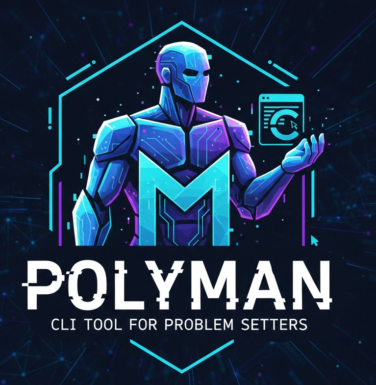

<div align="center">



# polyman

**CLI tool for Codeforces problem setters** to create, test and verify competitive programming problems from the terminal.

[](https://github.com/HamzaHassanain/polyman/actions/workflows/ci.yml)
[](https://www.npmjs.com/package/polyman-cli)
[](https://opensource.org/licenses/MIT)
[](https://www.typescriptlang.org/)
[](https://nodejs.org/)
[](https://hamzahassanain.github.io/polyman/)
[](http://makeapullrequest.com)

---

**Quick Links** | [What is new](#what-is-new-in-31) • [Why?](#why-polyman) • [Who uses it](#who-uses-it) • [Installation](#installation) • [Quick Start](#quick-start) • [Chat](#chat-preview) • [Commands](#commands) • [Tags](#solution-tags) • [Checkers](#standard-checkers) • [Structure](#project-structure) • [Config](#configuration) • [Docs](#documentation) • [Workflow](#workflow-summary) • [Issues](#common-issues) • [Support](#support) • [Contributing](#contributing) • [License](#license)

</div>

polyman (`polyman-cli` on npm, MIT) is the command-line tool problem setters on Codeforces and Polygon run before a problem goes out. It compiles every solution, runs it on every test, and checks that each one gets the verdict its tag says. It also pulls problems from Polygon and pushes them back, so you can do the whole work locally.

## What is new in 3.1

- A precompiled `<bits/stdc++.h>` is built once and reused for every C++ compile that includes it, so a cold `verify` is faster. Turn it off with `POLYMAN_PCH=0`.
- `--json` works on `generate`, `validate`, `test` and the `remote` commands, not only on `run` and `verify`.
- C++ solutions are compiled with `-DONLINE_JUDGE`, like on Codeforces, and `remote pull` keeps each file's `sourceType`.
- Tags work like on Polygon: a `WA` solution passes on Wrong Answer or Presentation Error, and a `PE` solution must get a Presentation Error.
- `run` and `verify` use only `test<N>.txt` files, so a stray `test1.txt.bak` is not run as a test.
- A solution tagged `RE` must crash on at least one test.
- `remote pull` downloads the problem's resource files, like its own `testlib.h`. `download-testlib` does not replace a `testlib.h` that is different from the upstream one (exit code 2).
- Problems with file input and output work: when `inputFile` or `outputFile` in `Config.json` is a file name, each solution reads and writes that file.

The last four are merged after 3.1.0 and are listed under Unreleased in [CHANGELOG.md](CHANGELOG.md).

3.1 was built with Ahmed Faraj and Mazen Ghanayem during the GitLab Transcend hackathon, October 2026 ([project on GitLab](https://gitlab.com/gitlab-ai-hackathon/transcend-october-2026/30770856/showcase)).

## Why Polyman?

Stop switching between environments. Create competitive programming problems entirely in your terminal:

- **Problem Templates** – Generate complete folder structures in one command  
- **Test Generation** – Automate test case creation with C++ generators  
- **Validation** – Validate inputs against problem constraints  
- **Multi-Solution Testing** – Test correct, wrong, TLE, and RE solutions simultaneously  
- **Smart Checkers** – Use standard checkers or write custom ones  
- **Complete Verification** – Full workflow in a single `verify` command  
- **Polygon Sync** – Pull problems, work locally, push changes back  
- **Multi-Language** – C++, Java, and Python support

Polyman eliminates manual testing and syncing, letting you focus on problem design.

## Who uses it

Problem setters who prepared real problems with polyman:

- [Repovive](https://repovive.com) used polyman to prepare contest problems. For example, Graph Tiling, [problem F of Repovive Standard Round 3](https://repovive.com/contests/8/problems/F).
- Hamza Hassanain also used it for problems he set outside Repovive.
- Ahmed Faraj and Mazen Ghanayem used it to prepare problems for the ICPC Arab regional (ACPC).
- Mohamed Farag ([El_Farag](https://codeforces.com/profile/El_Farag) on Codeforces), who sets problems for ECPC and ACPC, ran polyman 3.0.3 on three of his own Polygon problems and wrote a [field report](https://gitlab.com/gitlab-ai-hackathon/transcend-october-2026/30770856/showcase/-/work_items/106). Four of the problems he found are fixed in 3.1.0.

People who ran polyman, hit a problem and sent a fix or a report:

| Who | What they did |
|---|---|
| [Gustavo Harnisch](https://github.com/Gustavo-Harnisch) | [PR #22](https://github.com/HamzaHassanain/polyman/pull/22): commands failed for problems in folders with spaces or shell characters in the path. He fixed the quoting. |
| [ElectLive](https://github.com/ElectLive) | [PR #98](https://github.com/HamzaHassanain/polyman/pull/98): one time limit for every language was unfair to Java and Python. He added time limit multipliers per language for local runs. |
| [Pasit Nusso](https://github.com/montionugera), Systems & Full-Stack Engineer | [PR #96](https://github.com/HamzaHassanain/polyman/pull/96): the colors were hard to read on a light terminal. He added a light theme and `NO_COLOR` support. |
| [Andrii Kuts](https://github.com/Andrii-Kuts), IOI medalist | Reported that pushing generators to Polygon failed ([#19](https://github.com/HamzaHassanain/polyman/issues/19)) and a `ulimit` error ([#18](https://github.com/HamzaHassanain/polyman/issues/18)). Both are fixed. |
| [Daniel Zhu](https://github.com/xyzqm) | Asked for C++23 when running solutions and uploading to Polygon ([#17](https://github.com/HamzaHassanain/polyman/issues/17)). Done. |
| [Nông Hiền Đức](https://github.com/huyanhnongdo) | Asked to use another compiler, like `g++-15`, without changing the system default ([#21](https://github.com/HamzaHassanain/polyman/issues/21)). Done: the `compiler` block in Config.json. |

### What people said

From the comments on the [announcement on Codeforces](https://codeforces.com/blog/entry/148803) (November 2025). Ranks are from Codeforces on 25 Oct 2026. These are comments, not reports of use.

| Who | What they wrote |
|---|---|
| [AksLolCoding](https://codeforces.com/profile/AksLolCoding), international grandmaster | "Will definitely be using this in the future" |
| [cry](https://codeforces.com/profile/cry), international master | "woa" |
| [Ahmed_Salamaa](https://codeforces.com/profile/Ahmed_Salamaa), expert | "Great tool, thank you for making the problem-setting workflow so much easier I’ll definitely start using it on my upcoming problem" |
| [Mosaab.](https://codeforces.com/profile/Mosaab.), expert | "maaan this is really a game-changer!" |
| [Sanad_Jr](https://codeforces.com/profile/Sanad_Jr), specialist | "Amazing! I'm really excited to use it on my upcoming problem. I also hope I can contribute to making it even better!" |
| [Shawky_XR](https://codeforces.com/profile/Shawky_XR), specialist | "Great job Hamza It's really helpful" |
| [MoRa_UnderRated](https://codeforces.com/profile/MoRa_UnderRated) | "Woah, That's a mind blowing improvement <3 !" |
| [zaki-66](https://codeforces.com/profile/zaki-66) | "it's really helpful thanks for your efforts" |
| [Mawchin](https://codeforces.com/profile/Mawchin), [SalemAli](https://codeforces.com/profile/SalemAli), [hashiirama](https://codeforces.com/profile/hashiirama), [mad_scientist](https://codeforces.com/profile/mad_scientist) | "Thanks for this tool, it's really helpful !!!", "Awesome!", "Amazing!", "Helpful!" |

The most useful comment was a question. [Errichto](https://codeforces.com/profile/Errichto) (international grandmaster, legendary grandmaster at his peak) asked: "Has anybody used this tool and can recommend it? Or even better: can anybody compare this to polygon-cli?" [adamant](https://codeforces.com/profile/adamant) asked for the same comparison. The list above is our answer to the first part so far. The comparison with polygon-cli is still to do.

### Starred by

Some of the people who starred the repository, with what their own GitHub profile says:

- [Abdelrhman Sersawy](https://github.com/Abdelrhmansersawy) and [Ahmed Elseyoufi](https://github.com/seyoufi22): ICPC World Finalists
- [Andrii Kuts](https://github.com/Andrii-Kuts): IOI medalist
- [Islam Imad](https://github.com/Islam-Imad): 3x ACPC finalist, Candidate Master
- [Mohammed Nasser](https://github.com/Moagezaaa): problem setter and tester at Eolymp
- [Ismail El-Toukhy](https://github.com/Ismail-Mahmoud): ECPC silver medalist
- [Mohamed Abdelhady](https://github.com/Slim-Hady): ECPC finalist
- [Chisheng Chen](https://github.com/rota1001): competitive programmer
- [hungg261](https://github.com/hungg261): competitive programmer, Vietnam

<!-- Add a person here only with a link to what they did or said. A star or a comment is not use: write "uses" only when the person said so or sent a fix or report from real use. -->

## Installation

### System Requirements

- **Node.js** ^20.19.0 or ≥ 22.12.0
- **C++ Compiler** (g++ with C++23 support; set `cppStandard` in `Config.json` for older compilers, or pick another compiler with `POLYMAN_CXX` or `compiler.cpp`, see [GUIDE.md](GUIDE.md#local-compiler-overrides))
- **Python 3** (optional - for Python solutions)
- **Java JDK** (optional - for Java solutions)

### Quick Install

```bash
npm install -g polyman-cli
```

Build from source:

```bash
git clone https://github.com/HamzaHassanain/polyman.git
cd polyman && npm install && npm run build && npm link
```

Verify: `polyman --version`

## Quick Start

### Create & Test a Problem

```bash
# Create new problem
polyman new my-problem
cd my-problem

# Download testlib (required for validators/generators)
polyman download-testlib

# Run complete verification
polyman verify
```

### Work with Polygon

```bash
# Setup (one-time), with the key and secret from Polygon's settings
polyman remote register <api-key> <secret>

# Pull problem
polyman remote pull 123456 ./my-problem
cd my-problem

# Work locally, then push back (the problem ID comes from Config.json)
polyman remote push .
polyman remote commit . "Updated solutions"
```

## Chat (preview)

`polyman chat` is an AI agent in your terminal. You talk with it about a problem idea, it writes the spec with you, then a team of small workers builds the problem and the polyman CLI checks every step. It can also fix a failing `verify`, add stronger tests, and push to Polygon after you approve.

### Providers, keys and models

<!-- PROVIDERS: filled by the any-model PR -->

### Quick start

```bash
polyman chat my-problem           # a folder with Config.json, or a new problem
polyman chat my-problem --plain   # line mode, works with pipes
```

- The default model is Gemma 4 on OpenRouter. `--model <id>` picks another one.
- File writes ask you first (`shift+tab` switches to `auto-edit`), a workflow asks once for its whole plan, and Polygon changes always ask.
- The agent works only inside the problem folder and runs only polyman commands, never a shell.
- What you send to the model provider: your messages, the files the agent reads and the output of the commands it runs.

Full chapter: [GUIDE.md - Chat (AI agent)](GUIDE.md#chat-ai-agent), with the keys, the workflows, safety and privacy, and the known limits.

## Commands

### Essential Commands

| Command                        | Purpose                                       |
| ------------------------------ | --------------------------------------------- |
| `polyman new <dir>`            | Create new problem template                   |
| `polyman chat <dir>`           | Chat with the AI agent (preview)              |
| `polyman ai <command>`         | Manage AI provider keys and the default model |
| `polyman download-testlib`     | Download testlib.h header                     |
| `polyman generate --all`       | Generate all test cases                       |
| `polyman validate --all`       | Validate test inputs                          |
| `polyman run <solution> --all` | Run solution on all tests                     |
| `polyman test <component>`     | Test validator/checker/solution               |
| `polyman verify`               | Complete verification workflow                |
| `polyman verify --json`        | Same, as a JSON report on stdout              |
| `polyman cache status`         | Show cached compiled binaries                 |
| `polyman cache clear`          | Delete the compilation cache                  |

### Polygon Commands

| Command                                  | Purpose              |
| ---------------------------------------- | -------------------- |
| `polyman remote register <key> <secret>` | Save API credentials |
| `polyman remote list`                    | List your problems   |
| `polyman remote pull <id> <dir>`         | Download problem     |
| `polyman remote push <dir>`              | Upload changes       |
| `polyman remote view <id>`               | Show problem details |
| `polyman remote commit <id> "msg"`       | Commit changes       |
| `polyman remote package <id> <type>`     | Build package        |

`<id>` is a Polygon problem ID or a problem directory whose `Config.json` has `problemId`, so `polyman remote commit . "msg"` works inside a pulled problem.

For detailed usage, see [GUIDE.md](GUIDE.md#cli-commands-reference).

### Compilation cache

C++ builds are cached in `.polyman/cache/` inside the problem directory. A source is recompiled only when it, a local header it includes (such as `testlib.h`), `cppStandard`, the compiler (`POLYMAN_CXX` / `compiler.cpp`) or its version, or `compiler.flags` changes; otherwise the cached binary is reused and `verify` reports the time saved. Pass `--no-cache` to `generate`, `validate`, `run`, `test` or `verify` to force recompilation. See [GUIDE.md](GUIDE.md#compilation-cache).

### Terminal colors

polyman checks the terminal background when it starts and uses light colors on a white or light terminal, dark colors otherwise. If it picks the wrong one, set `POLYMAN_THEME=dark` or `POLYMAN_THEME=light` to force it. Set `NO_COLOR=1` (see [no-color.org](https://no-color.org)) to turn colors off. `NO_COLOR` wins over `FORCE_COLOR` and `POLYMAN_THEME`. See [GUIDE.md](GUIDE.md#terminal-colors).

### Shell completion

`polyman completion <bash|zsh|fish>` prints a completion script. Tab then completes commands, subcommands and options, and inside a problem directory it also completes testset names (`-t`), group names (`-g`, for the testset given before it), and solution names (`run <TAB>`, `test <TAB>`) read from `Config.json`. Without a `Config.json`, only commands and options are completed.

```bash
# bash: add to ~/.bashrc
eval "$(polyman completion bash)"

# zsh: add to ~/.zshrc, after compinit
eval "$(polyman completion zsh)"

# fish: save once
polyman completion fish > ~/.config/fish/completions/polyman.fish
```

The scripts are built from the CLI's own command list, so they stay current after an upgrade: re-run the line above (or reopen the shell, for `eval`). Installing the package does not change your shell setup.

### Scripting and AI agents

`run` and `verify` accept `--json`: stdout then carries exactly one JSON document and all human-readable output moves to stderr, so `polyman verify --json > verify.json` is safe to parse. The exit code is unchanged. `remote push` accepts `--yes` and `--name <slug>` so a new problem can be created without a terminal; without a TTY the command fails fast instead of waiting on a prompt. See [GUIDE.md](GUIDE.md#full-verification) for the report shape.

`polyman ai login|logout|list|models|use` saves API keys for AI model providers (OpenAI, Anthropic, DeepSeek, Qwen, Gemini, Groq, Mistral, OpenRouter, a local Ollama, or any OpenAI-compatible server) in `~/.polyman/ai.json` (mode 0600) and sets a default model; `polyman chat` uses these settings. See [GUIDE.md](GUIDE.md#ai-provider-keys).

## Solution Tags

Every solution needs a tag indicating its expected behavior:

| Tag  | Meaning            | Purpose                                |
| ---- | ------------------ | -------------------------------------- |
| `MA` | Main Correct       | **Required** - Reference solution      |
| `OK` | Correct            | Alternative correct approach           |
| `WA` | Wrong Answer       | Should get WA or PE on some tests      |
| `TL` | Time Limit         | Should timeout on some tests           |
| `TO` | Time/OK            | May TLE but is algorithmically correct |
| `ML` | Memory Limit       | Should exceed memory                   |
| `RE` | Runtime Error      | Should crash                           |
| `PE` | Presentation Error | Wrong format                           |
| `RJ` | Rejected           | Should fail for any reason             |

For full details, see [GUIDE.md - Solution Types](GUIDE.md#solution-tags).

## Standard Checkers

Run `polyman list checkers` to see the full set with descriptions. The most useful:

| Checker            | Use For                          |
| ------------------ | -------------------------------- |
| `ncmp`             | Sequence of numbers (most problems) |
| `wcmp`             | Sequence of tokens/words         |
| `dcmp` / `rcmp*`   | Floating-point numbers           |
| `yesno`            | Yes/No answers                   |
| `lcmp`             | Exact line comparison            |

Full reference: [GUIDE.md - Standard Checkers](GUIDE.md#available-standard-checkers).

## Project Structure

After `polyman new my-problem`, you get:

```
my-problem/
├── Config.json              # Problem configuration
├── solutions/               # Solution files (main + WA/TL/etc)
├── generators/              # Test generators
├── validator/               # Input validator
├── checker/                 # Custom checker (if needed)
├── statements/              # Problem statements
└── tests/                   # Generated test files
```

See [GUIDE.md - Directory Structure](GUIDE.md#directory-structure) for full details.

## Configuration

The `Config.json` file defines your problem:

```json
{
  "name": "problem-name",
  "timeLimit": 2000,
  "memoryLimit": 256,
  "inputFile": "stdin",
  "outputFile": "stdout",
  "solutions": [
    {
      "name": "main",
      "source": "./solutions/main.cpp",
      "tag": "MA",
      "sourceType": "cpp.g++17"
    }
  ],
  "generators": [
    {
      "name": "gen",
      "source": "./generators/gen.cpp"
    }
  ],
  "checker": {
    "name": "ncmp",
    "isStandard": true
  },
  "validator": {
    "name": "validator",
    "source": "./validator/validator.cpp"
  },
  "testsets": [
    {
      "name": "tests",
      "generatorScript": {
        "script": "<#list 1..50 as i>\ngen ${i} > $\n</#list>"
      }
    }
  ]
}
```

See [GUIDE.md - Configuration Reference](GUIDE.md#configuration-file-reference) for complete documentation.

## Documentation

Choose your learning path:

### For Beginners

**[Complete User Guide](GUIDE.md)** - Comprehensive reference with configuration examples, validators, generators, checkers, and best practices.

### Step-by-Step

**[Step-by-Step Tutorial](TUTORIAL.md)** - Learn by creating a simple "Sum of Two Numbers" problem from scratch.

### For Developers

**[Technical Documentation](DOCUMENTATION.md)** - Architecture overview, type system, API reference, and implementation details.

### Platform-Specific

**[Windows Notes](NOTES.md)** - Important considerations for Windows users regarding line endings and process cleanup.

### API Reference

**[TypeDoc Documentation](https://hamzahassanain.github.io/polyman/)** - Generated API documentation for developers.

## Workflow Summary

1. **Create** → `polyman new my-problem`
2. **Setup** → `polyman download-testlib` + edit Config.json
3. **Implement** → Write solutions, validator, generator, checker
4. **Generate** → `polyman generate --all`
5. **Verify** → `polyman verify`
6. **Sync** → `polyman remote push .` + `polyman remote commit . "msg"`

Detailed walkthrough: [GUIDE.md - Complete Workflow Example](GUIDE.md#complete-workflow-example)

## Common Issues

**Q: My test times out. How do I debug?**  
See [GUIDE.md - Troubleshooting](GUIDE.md#troubleshooting) for performance tips and debugging strategies.

**Q: Do I need a custom checker?**  
For most problems, a standard checker like `wcmp` or `ncmp` is sufficient. See [GUIDE.md - FAQ](GUIDE.md#faq).

**Q: Windows users: Process not killed on TLE?**  
Check [NOTES.md](NOTES.md#solutions-validators-generators-and-checkers-that-exceed-the-time-limit) for cleanup instructions.

## Support

- **Issues**: [GitHub Issues](https://github.com/HamzaHassanain/polyman/issues)
- **Documentation**: [https://hamzahassanain.github.io/polyman/](https://hamzahassanain.github.io/polyman/)
- **Codeforces**: [https://codeforces.com/](https://codeforces.com/) • [Polygon](https://polygon.codeforces.com/)

## Contributing

Contributions welcome! To contribute:

1. Fork the repository
2. Create a feature branch: `git checkout -b feature/your-feature`
3. Make changes with clear commit messages
4. Push and open a Pull Request

Please ensure code follows the existing style and includes tests.

### CI

GitHub Actions runs these checks on a pull request:

- `ci`: format check, lint, the unit tests with coverage, and the build, on Node 20 and 22.
- `corpus`: real problems with wrong solutions on purpose, judged with real compilers. It runs when the PR changes `src/`, `corpus/`, `template/`, `assets/` or the dependencies. See [corpus/README.md](corpus/README.md).
- `mutation`: mutation testing of the verdict code. It runs when the PR changes `src/helpers/solution.ts`, `src/types.d.ts` or the tests.
- `codeql`: code scanning.

The Windows unit tests and the macOS corpus run on pushes to `master` and on demand.

## License

MIT License. See [LICENSE](LICENCE) for details.

## Acknowledgments

- **testlib** by Mike Mirzayanov - Validators, generators, and checkers
- **Codeforces** - Platform and community
- **Contributors** - All who have helped improve Polyman
