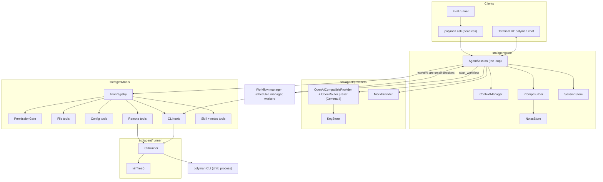
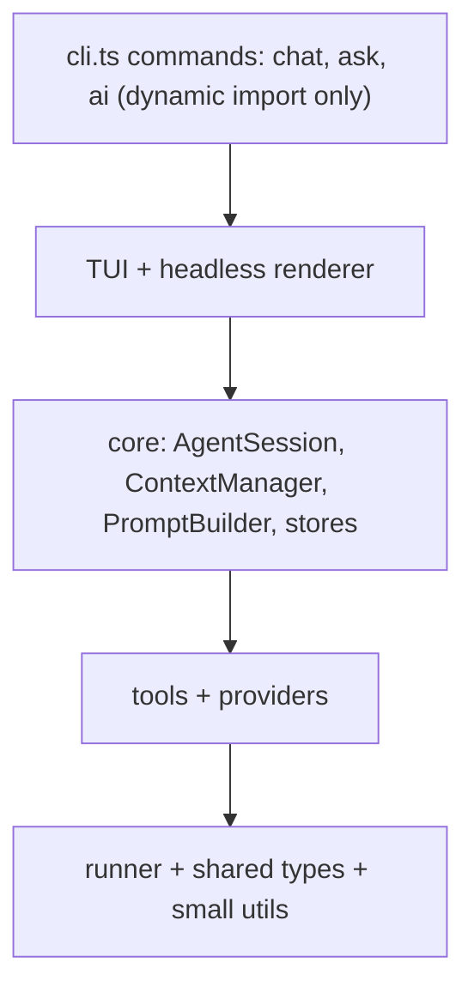
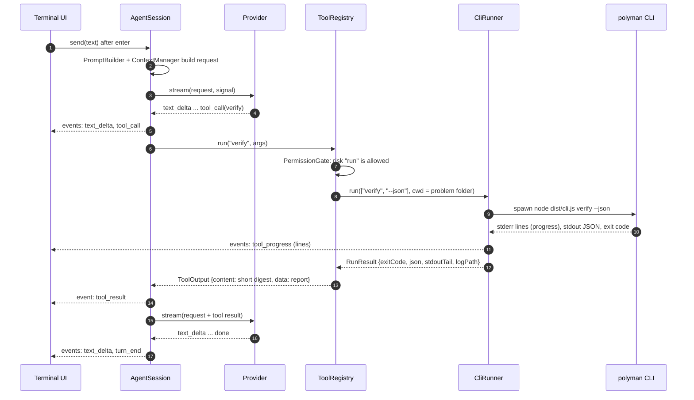
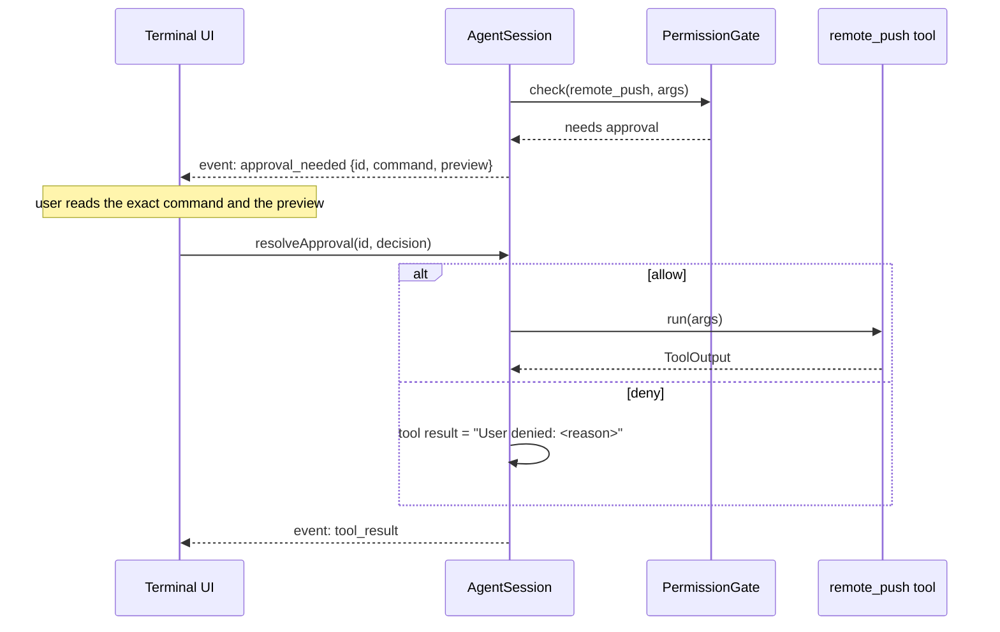
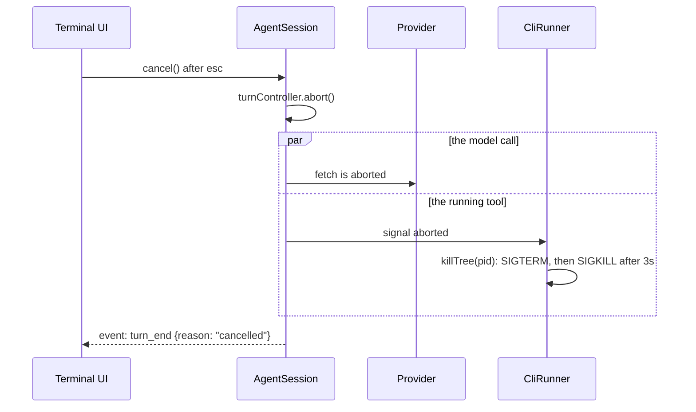
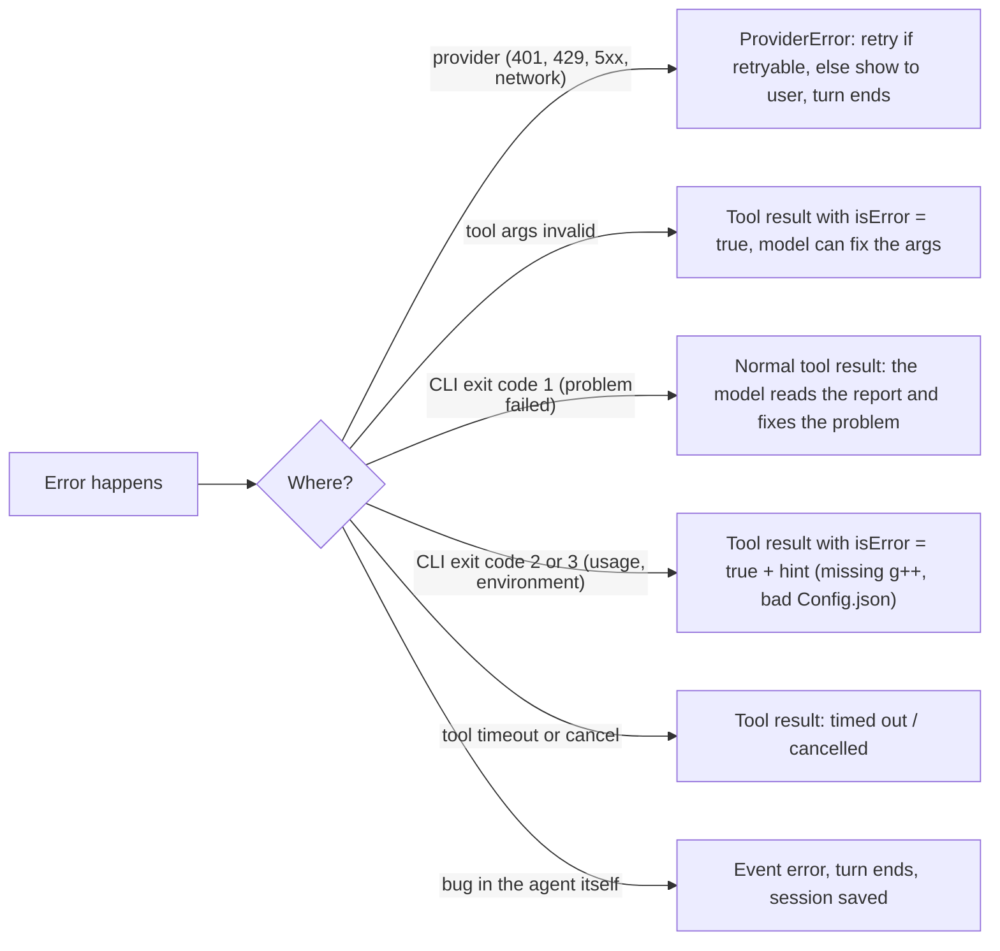

# 01: Architecture

This file is the map. The other files go deeper into each part.

## Components



## Layers and import rules

Each layer may only import from the layers under it. This keeps the parts testable on their own.



Rules:

- `src/agent/**` never imports `actions.ts`, `steps.ts` or `helpers/**` that print or exit. It runs the CLI instead (decision D1).
- It may import pure modules that do not print or exit, like `types.d.ts` and the JSON report types.
- `cli.ts` loads the agent with `await import('./agent/index.js')`, so normal commands do not load it.
- Providers know nothing about tools running. Tools know nothing about providers.

## Source layout

```
src/agent/                 CommonJS like the rest of polyman (only tui/ is ESM)
  index.ts                 startChat(), createChatRuntime()
  ai-commands.ts           polyman ai login/logout/list/models/use (exists)
  secret-input.ts          hidden key prompt (exists)
  core/
    session.ts             AgentSession: the loop, turns, steps, cancel
    events.ts              AgentEvent union + EventBus
    messages.ts            Message, ContentPart (provider-neutral, exists)
    context.ts             ContextManager: budget, truncation, compaction
    prompt.ts              PromptBuilder: system prompt from parts
    session-store.ts       JSONL sessions on disk
    notes.ts               NotesStore: read/update notes.md
  providers/
    types.ts               Provider, ChatRequest, StreamEvent, ModelInfo (exists)
    openai-compatible.ts   OpenAI-compatible adapter, used for OpenRouter (exists)
    anthropic.ts           Anthropic adapter (exists, not tuned)
    presets.ts             providers and models; OpenRouter gets the Gemma 4 models (exists)
    capabilities.ts        context window, tools, chat-only fallback (exists)
    key-store.ts           ~/.polyman/ai.json (0600), env vars, redact (exists)
    retry.ts               backoff, retry-after (exists)
    sse-parser.ts          parse text/event-stream (exists)
    mock.ts                scripted provider for tests and evals (exists)
    gemma.ts               Gemma budgets and the chat provider factory (new)
  tools/
    types.ts               Tool, ToolContext, ToolOutput, Risk
    registry.ts            register, list specs, validate args, dispatch
    permissions.ts         PermissionGate: policies, session rules, approvals
    schema.ts              small JSON schema validator (subset)
    sandbox.ts             resolve paths inside the problem folder
    fs-tools.ts            list_files, read_file, write_file, edit_file
    config-tools.ts        read_config, update_config
    cli-tools.ts           create_problem, generate, validate, run_solution, test, verify, stress
    remote-tools.ts        remote_pull, remote_push, remote_commit, remote_view, remote_package
    skill-tools.ts         list_skills, load_skill
    notes-tools.ts         read_notes, update_notes
  workflow/                the Gemma workflow manager (see 10-workflow-manager.md)
    types.ts               Plan, PlanTask, TaskResult, TaskKind
    recipes.ts             build_problem, fix_verify, strengthen_tests
    manager.ts             submit_plan, decide
    worker.ts              one task = one small AgentSession
    checkpoints.ts         CLI checks per task kind
    scheduler.ts           DAG, parallel limit, retries, escalation, config patches
    prompts.ts             manager and worker prompts
  runner/
    cli-runner.ts          spawn polyman, collect output, timeout, cancel, one lock for CLI runs
    kill-tree.ts           kill a process tree on POSIX and Windows
  tui/                     terminal UI with Ink, ESM: has its own package.json with "type": "module" (see 05-chat-ui.md)
    index.tsx              startTui(session)
    App.tsx, store.ts, keybindings.ts
    components/            Transcript, ToolBlock, ApprovalPrompt, Composer, StatusLine, ...
  headless/
    ask.ts                 polyman ask: text or --json renderer
evals/                     eval cases and runner (not shipped)
```

## Main flows

### A chat turn with one tool call



### A tool call that needs approval



### Cancel



The session stays alive after a cancel. Only the current turn stops.

## Data on disk

| Path | What | Who writes it |
| --- | --- | --- |
| `~/.polyman/credentials.json` | Polygon key and secret (exists today) | `polyman remote register` |
| `~/.polyman/ai.json` | The OpenRouter key and the Gemma 4 model to use. Mode `0600`. | `polyman ai login`, `polyman ai use` |
| `~/.polyman/agent/sessions/` | Sessions that started before a problem folder existed | SessionStore |
| `<problem>/.polyman/agent/notes.md` | Long-term memory of the problem | NotesStore, `update_notes` tool |
| `<problem>/.polyman/agent/sessions/<id>.jsonl` | One file per chat, append-only | SessionStore |
| `<problem>/.polyman/agent/logs/<callId>.log` | Full output of each CLI run | CliRunner |
| `<problem>/.polyman/cache/` | Compile cache (exists today) | CLI |

The agent never reads `credentials.json` or `ai.json` through its tools. The sandbox blocks paths outside the problem folder.

## Error model



The rule: a failed tool is information for the model, not a crash. Only provider errors that cannot be retried and bugs in the agent end a turn.

## Security model

| Risk | What we do |
| --- | --- |
| The model writes outside the problem | All file tools go through `sandbox.ts`: resolve the real path and refuse anything outside the problem folder, and refuse `.polyman/cache`. The check compares with the folder path plus a trailing separator, so `/x/pairs-evil` is not inside `/x/pairs`. |
| The model changes Polygon by mistake | Remote tools are risk `remote` and always need approval. The UI shows the exact command. |
| Prompt injection from pulled statements or files | Content from files is data. Dangerous actions still need approval, so injected text cannot push or commit. |
| The API key leaks | The OpenRouter key stays in `ai.json`, is sent only to `openrouter.ai`, and is removed from logs, errors and session files. |
| Unreleased problems leak | Everything the agent reads goes to OpenRouter and the host that runs Gemma. Clear notice on the first use. Running Gemma locally with Ollama is the later fix for private problems. |
| Code written by the model runs on the machine | This is the real risk. The model writes solutions, generators, validators and checkers, and the CLI compiles and runs them. Time and memory limits do not stop a generator that calls `system("rm -rf ~")`. So "no free shell" is only true while writes need approval. In `ask` mode (the default) the user sees every file before it is written. Switching to `auto-edit` shows a clear warning that the model can then run any code it writes. |

## Testing strategy

| Layer | How we test it |
| --- | --- |
| Providers | Recorded SSE streams as fixtures, fed to the parser and adapters. No network in CI. |
| CliRunner | A tiny fake CLI script that prints, sleeps, exits with codes, or spawns children (to test `killTree`). |
| Tools | Temp problem folders made from `template/`, with the runner mocked or real. |
| AgentSession | `MockProvider` with a script of replies and tool calls. Check the events and the saved session. |
| Terminal UI | The reducer over `AgentEvent` alone in Vitest, components with `ink-testing-library`. |
| End to end | `polyman ask` with the `MockProvider` on a temp copy of the template problem. |
| Quality of the agent | The eval suite with Gemma 4 through OpenRouter, not in CI (see [08-evals-release.md](08-evals-release.md)). |
