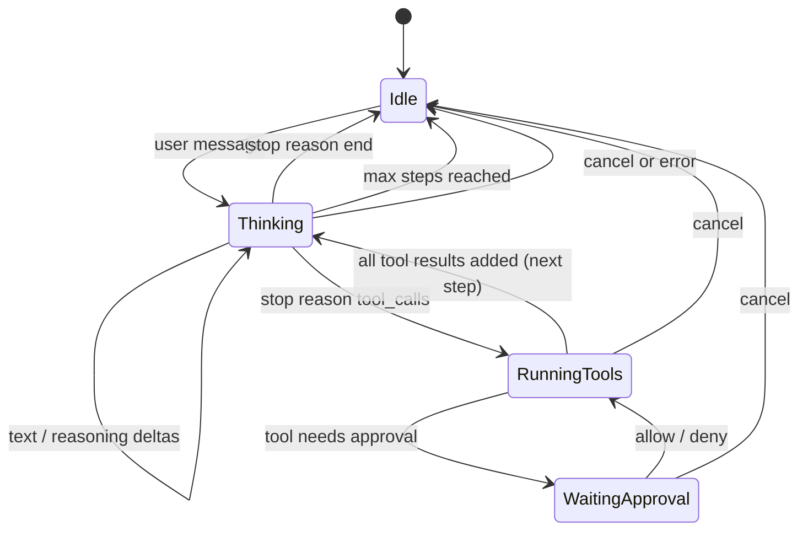
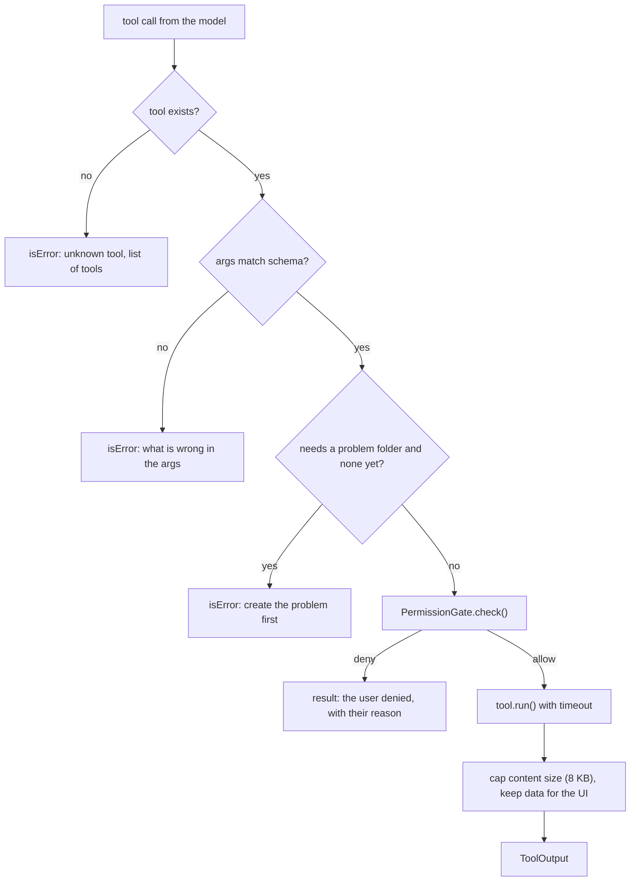
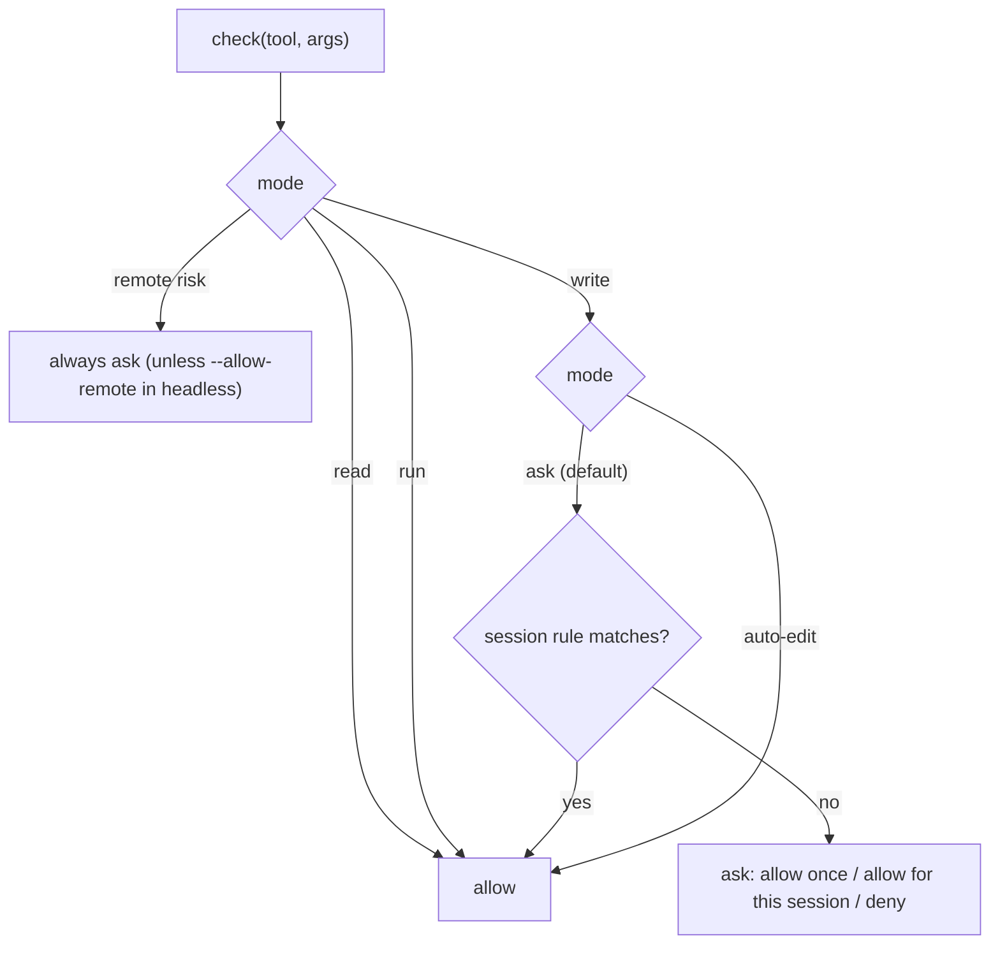
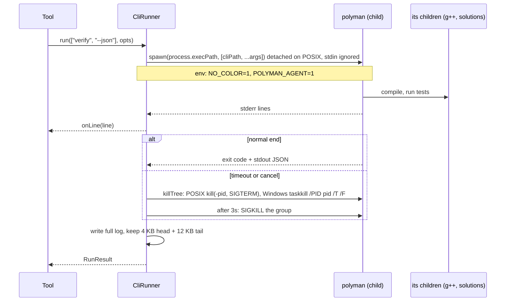
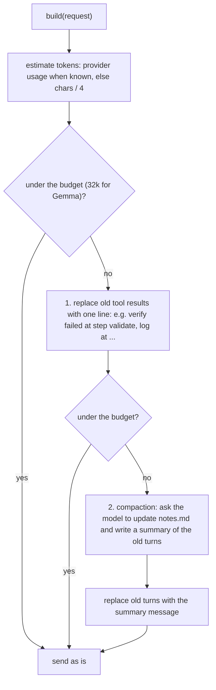

# 04: Harness (M2)

The harness is everything between the model and the problem folder: the loop, the tools, the permissions, the CLI runner, the sessions and the context.

## AgentSession: the loop

One `AgentSession` per open chat. It owns the messages, the current turn and the settings.



```ts
class AgentSession {
  constructor(deps: {
    provider: Provider;
    model: ResolvedModel;
    tools: ToolRegistry;
    permissions: PermissionGate;
    context: ContextManager;
    prompt: PromptBuilder;
    store: SessionStore;
    bus: EventBus<AgentEvent>;
    problemDir: string | null;
  });

  send(text: string): Promise<void>;  // runs one turn, returns when the turn ends
  cancel(): void;                     // aborts the current turn only
  resolveApproval(id: string, decision: ApprovalDecision): void;
  setModel(model: ResolvedModel): void;
}
```

The turn, in short:

```ts
async runTurn(userText: string, signal: AbortSignal) {
  this.append(userMessage(userText));
  for (let step = 0; step < this.maxSteps; step++) {      // default 20 for Gemma
    const req = await this.context.build(this.prompt, this.messages, this.tools.specs());
    const reply = await this.streamStep(req, signal);       // emits deltas
    this.append(reply.message);
    if (reply.toolCalls.length === 0) return this.endTurn('done');
    for (const call of reply.toolCalls) {                   // one at a time, in order
      const result = await this.tools.run(call, this.toolContext(signal));
      this.append(toolResultMessage(call.id, result));
    }
  }
  this.endTurn('max_steps');                                // tell the user, they can say "continue"
}
```

Tool calls run one at a time inside one session, even if the model asks for several in one step. Workflow workers are separate sessions and run in parallel, but all CLI runs go through one lock in `CliRunner`. Running two CLI commands on the same folder at the same time is not safe (both write `testsets/`, both measure time).

Repeat guard: the session remembers the last tool calls. If the model makes the same call with the same args 3 times in a turn, the call is not run again. The result says "you already did this, the result was: ... Try something else or ask the user." Smaller models like Gemma get stuck this way, and it costs money.

## Events

All output of the core is events. The terminal UI, `polyman ask` and the evals all read the same events.

```ts
type AgentEvent =
  | { type: 'turn_start'; turnId: string }
  | { type: 'text_delta'; text: string }
  | { type: 'reasoning_delta'; text: string }
  | { type: 'tool_call'; callId: string; name: string; args: unknown; risk: Risk }
  | { type: 'approval_needed'; approvalId: string; callId: string; title: string; command?: string; preview?: string }
  | { type: 'approval_resolved'; approvalId: string; decision: ApprovalDecision }
  | { type: 'tool_progress'; callId: string; line: string }
  | { type: 'tool_result'; callId: string; ok: boolean; summary: string; data?: unknown }
  | { type: 'usage'; inputTokens: number; outputTokens: number; costUsd?: number }
  | { type: 'notes_updated'; notes: string }
  | { type: 'problem_dir_changed'; problemDir: string }
  | { type: 'compacted'; removedMessages: number }
  | { type: 'turn_end'; turnId: string; reason: 'done' | 'cancelled' | 'max_steps' | 'error'; error?: string };
```

`EventBus` is a simple typed emitter. Each event gets a growing `seq` number, which makes the session file and the eval logs easy to read in order.

## Tools

```ts
type Risk = 'read' | 'write' | 'run' | 'remote';

interface Tool<A = unknown> {
  name: string;               // snake_case, shown to the model
  description: string;        // when to use it, in plain words
  parameters: JSONSchema;     // object schema
  risk: Risk;
  needsProblem: boolean;      // false only for create_problem, skills, notes before scaffold
  timeoutMs?: number;
  describe?(args: A): { title: string; command?: string }; // for approvals and the UI
  run(args: A, ctx: ToolContext): Promise<ToolOutput>;
}

interface ToolContext {
  problemDir: string | null;
  signal: AbortSignal;
  runner: CliRunner;
  sandbox: Sandbox;
  progress(line: string): void;     // becomes tool_progress events
  setProblemDir(dir: string): void; // only create_problem uses it
}

interface ToolOutput {
  content: string;        // what the model reads: short and exact
  isError?: boolean;
  data?: unknown;         // full data for the UI (e.g. the VerifyReport)
}
```

`ToolRegistry.run()` does the same steps for every tool:



### First tool list

| Tool | Risk | Runs |
| --- | --- | --- |
| `list_files`, `read_file` | read | file system |
| `write_file`, `edit_file` | write | file system (edit = exact string replace, must match once) |
| `read_config` | read | `Config.json` |
| `update_config` | write | JSON patch on `Config.json`, checked against `Config.schema.json` |
| `list_skills`, `load_skill` | read | `template/instructions/*.md` |
| `read_notes`, `update_notes` | read / write | `.polyman/agent/notes.md` |
| `create_problem` | write | `polyman new <dir>` + `polyman download-testlib` |
| `generate`, `validate` | run | `polyman generate/validate ... --json` |
| `run_solution` | run | `polyman run <name> ... --json` |
| `test_target` | run | `polyman test <validator/checker/solution> --json` |
| `verify` | run | `polyman verify --json` |
| `stress` | run | `polyman stress ... --json` (new command, M3) |
| `remote_*` | remote | `polyman remote ...` (M4) |

## PermissionGate



- Modes: `ask` (default), `auto-edit` (writes inside the problem are allowed), `--yes` in headless mode (everything except `remote` unless `--allow-remote`).
- Switching to `auto-edit` shows a warning: the model can now write code and run it through `generate`, `run` or `verify` without asking. See the security model in [01-architecture.md](01-architecture.md).
- "Allow for this session" adds a rule like `{ tool: 'write_file' }` that lives until the session ends.
- The approval waits on a promise that `resolveApproval()` resolves. A cancel rejects it.
- For `write_file` and `edit_file`, the approval shows a diff.
- Inside a workflow, the user approves the whole plan once. Each worker then gets a sandbox limited to its task's `ownsFiles`, and writes there without asking. See [10-workflow-manager.md](10-workflow-manager.md).

## Sandbox

```ts
class Sandbox {
  constructor(problemDir: string);
  resolve(userPath: string, mode: 'read' | 'write'): string; // throws if outside
}
```

- Resolve with `fs.realpath` (also for the parent folder of a new file), then check that it is the real problem folder or starts with the real problem folder plus `path.sep`. Without the separator, `/x/pairs-evil` would pass as inside `/x/pairs`.
- Refuse writing to `.polyman/cache/`, `.polyman/agent/sessions/` and `testlib.h`.
- `read_file` returns at most 2000 lines and supports `offset` and `limit`. Test files are cut to the first and last lines.

## CliRunner

```ts
interface RunOptions {
  cwd: string;
  timeoutMs: number;
  signal: AbortSignal;
  onLine?(line: string): void; // stderr lines for tool_progress
}
interface RunResult {
  exitCode: number | null;  // null when killed
  reason: 'exited' | 'timeout' | 'cancelled';
  json?: unknown;           // parsed stdout when --json
  stdoutTail: string;
  stderrTail: string;
  logPath: string;          // full output on disk
  durationMs: number;
}
class CliRunner {
  run(args: string[], opts: RunOptions): Promise<RunResult>;
}
```



- `cliPath` is our own `dist/cli.js` (`path.join(__dirname, '..', '..', 'cli.js')`), not `polyman` from PATH, so the agent always uses the same version.
- On POSIX we start the child as a process group leader, so killing the group also kills compilers and running solutions.
- On Windows signals do not run cleanup handlers, so `taskkill /T` is the only safe way. This needs real testing on Windows (see `NOTES.md`).

## SessionStore

One JSONL file per session. Each line is one record, appended right away, so a crash loses at most one line.

```jsonl
{"type":"meta","id":"s_01","createdAt":"...","model":"google/gemma-4-31b-it","problemDir":null}
{"type":"message","message":{"id":"m1","role":"user","parts":[{"type":"text","text":"I have an idea about ..."}]}}
{"type":"message","message":{"id":"m2","role":"assistant","parts":[...]}}
{"type":"approval","callId":"c3","decision":"allow"}
{"type":"usage","inputTokens":1200,"outputTokens":300}
{"type":"compaction","summary":"...","replaces":["m1","m2"]}
{"type":"problem_dir","path":"/home/u/problems/pairs"}
```

- A session starts in `~/.polyman/agent/sessions/` when there is no problem folder yet.
- When `create_problem` runs, the file moves to `<problem>/.polyman/agent/sessions/`.
- Resume = read the file and rebuild the messages, taking compactions into account.
- Keys are never written (`redact()` runs on every record).

## ContextManager

Problem setting makes long sessions: many files and many verify reports. Gemma 4 has a 262k window, but we keep a much smaller budget (32k tokens to start), because a smaller model follows the rules worse in a long context, and every step re-sends the whole context.



- The system prompt, the notes and the last 4 turns are never removed.
- Old file contents can always be read again with `read_file`, so dropping them is safe.
- Compaction emits a `compacted` event, so the user knows.

## PromptBuilder

The system prompt is built from parts, in this order (stable parts first, which helps provider caching):

1. Role and rules: who the agent is, how to work, when to ask the user, never push without approval.
2. Tool rules: prefer `edit_file` over `write_file` for small changes, always run `verify` after changes, read the report before fixing.
3. The skills index: names and one line each (from `template/instructions/`).
4. The environment: OS, which compilers are available (checked once at start), polyman version.
5. The problem state: notes.md, a short summary of `Config.json`, the file tree (only names).

Details of parts 1, 3 and 5 are in [06-problem-agent.md](06-problem-agent.md).

## `polyman ask` (headless)

```
polyman ask "write a validator for the constraints in the statement" [--dir <problem>] [--model <gemma-4 id>]
           [--yes] [--allow-remote] [--json] [--resume <sessionId>] [--max-steps 20]
```

- Same `AgentSession`, with a plain text renderer instead of the Ink UI.
- Without `--yes`, an approval prints the question and reads y/n from the terminal. When stdin is not a terminal, approvals are denied and the agent is told why.
- `--json` prints all events as JSON lines. This is what the evals use.
