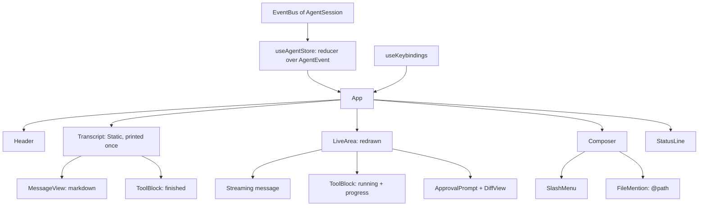
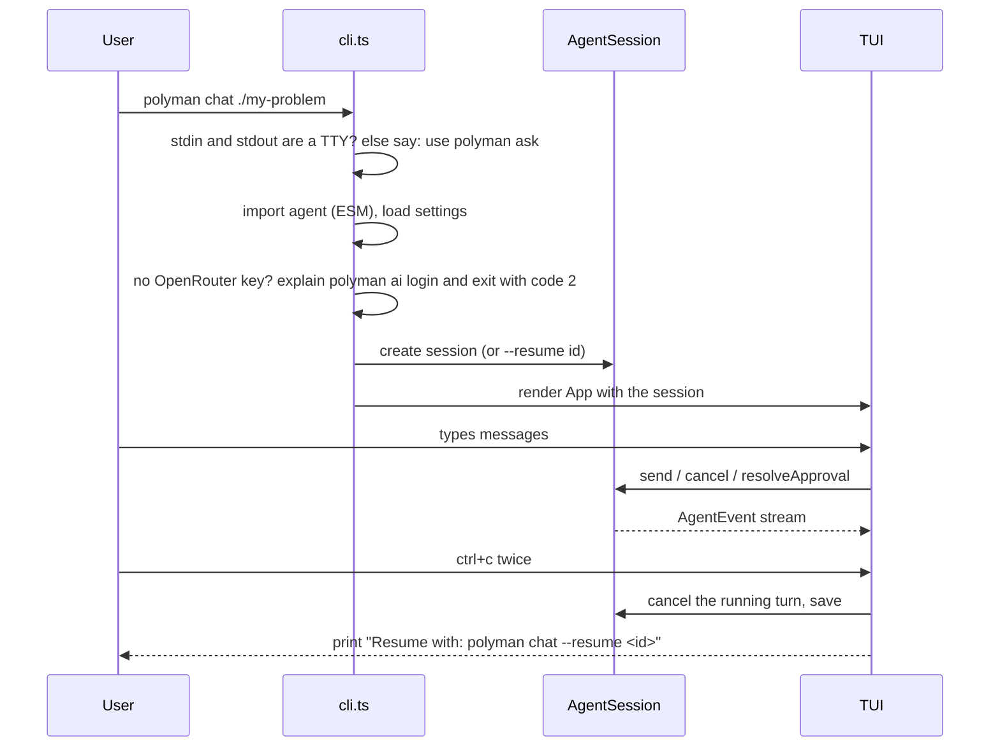

# 05: Terminal chat UI (M2 first version, M5 polish)

`polyman chat` runs in the terminal, like Claude Code or Codex. No browser, no server.

## How it looks

```
$ polyman chat ./pairs-sum

 polyman chat  ·  pairs-sum  ·  gemma-4-31b (OpenRouter)  ·  /help for commands

> I have an idea: count pairs with sum k, n up to 2e5

● Nice. Before we build anything, let us fix the task:
  1. Are the pairs ordered (i < j)?
  2. Can values repeat?
  ...

> yes i < j, values can repeat. go ahead and build it

● update_notes(Constraints)
  ⎿ notes updated

● write_file(validator/val.cpp)

 ┌ Write validator/val.cpp? ───────────────────────────────────────────┐
 │ + #include "testlib.h"                                              │
 │ + int main(int argc, char* argv[]) {                                │
 │ +     registerValidation(argc, argv);                               │
 │ ...                                                                 │
 │ ❯ 1. Yes                                                            │
 │   2. Yes, and do not ask again for writes in this session           │
 │   3. No, and tell the agent what to do differently                  │
 └─────────────────────────────────────────────────────────────────────┘

● verify
  ⎿ Running wa-overflow.cpp on tests ... (12/24)

────────────────────────────────────────────────────────────────────────
> _
────────────────────────────────────────────────────────────────────────
 pairs-sum · gemma-4-31b · ask mode (shift+tab) · 12.3k tok · $0.01 · esc to interrupt
```

## Main ideas

- **Normal terminal scrollback.** Finished messages are printed once and stay in the terminal history, so the user can scroll and copy with the terminal itself. Only the bottom part (the message being streamed, running tools, the prompt) is redrawn. This is how Claude Code works, and it is the main reason to use Ink's `<Static>`.
- **Everything is in-process.** The TUI subscribes to the `EventBus` of the `AgentSession` and calls its methods directly. No HTTP, no ports, no token.
- **Tool calls are short by default.** One line for the call, one line for the result. `ctrl+o` expands the last tool output.
- **Approvals are inline prompts** with a diff for file writes, chosen with the arrow keys or the number keys.

## Tech choice: Ink

We use [Ink](https://github.com/vadimdemedes/ink) (React for the terminal). Claude Code and Gemini CLI are built with it.

| Option | Good | Bad |
| --- | --- | --- |
| Ink + React (chosen) | Components, state and re-render are solved. Used by the tools users compare us with. | New runtime dependencies (`ink`, `react`), about 23 MB installed. ESM-only. |
| Our own renderer with `readline` + ANSI | No dependencies | Streaming, redraw, input editing, approvals and resize are a lot of work and easy to get wrong |
| Blessed / neo-blessed | Full-screen widgets | Full-screen breaks the normal scrollback, and the projects are not active |

This changes our "3 runtime deps" rule, so it is a conscious decision: `ink` and `react` become runtime dependencies, but they are only loaded by `polyman chat`. Other commands do not load them, so `polyman verify` does not get slower.

### ESM loading

`require('ink')` fails with `ERR_REQUIRE_ASYNC_MODULE` (Ink uses top-level await), and `import('ink')` works. So:

- The agent code stays CommonJS like the rest of polyman. Only `src/agent/tui/` has its own `package.json` with `{ "type": "module" }`. TypeScript (`module: nodenext`) then compiles that folder to ESM, also the `.tsx` files. Relative imports inside it end in `.js`.
- The build copies `src/agent/tui/package.json` to `dist/agent/tui/package.json`, and `package.json` `files` lists it (today only `dist/**/*.js` is shipped).
- `src/agent/index.ts` (CommonJS) loads the UI with `await import('./tui/index.js')`, which works from CommonJS. The ESM UI imports the CommonJS agent modules normally (Node gives named exports for TypeScript's CommonJS output).
- `tsconfig.json` gets `"jsx": "react-jsx"`, and ESLint gets the `.tsx` files.

## Components



```
src/agent/tui/
  index.tsx              startTui(session): render(<App/>), handle exit
  App.tsx
  store.ts               reducer over AgentEvent (no Ink inside, tested alone)
  keybindings.ts
  components/
    Header.tsx
    Transcript.tsx       <Static> list of finished items
    MessageView.tsx
    Markdown.tsx         small terminal markdown: headings, bold, lists, code blocks
    ToolBlock.tsx
    ApprovalPrompt.tsx
    DiffView.tsx
    Composer.tsx         multi-line input, history, paste
    SlashMenu.tsx
    StatusLine.tsx
    PlanView.tsx         live workflow task tree + plan approval (see 10-workflow-manager.md)
    views/
      NotesView.tsx      /plan: notes.md checklist
      VerifyView.tsx     /verify: last verify report as a table
      FilesView.tsx      /files: files changed in this session
```

Markdown: we parse with the `marked` lexer (small, no dependencies) and draw the tokens with Ink. No syntax highlighting in the first version, only a different color for code blocks.

## Keys

| Key | Action |
| --- | --- |
| `enter` | send |
| `shift+enter` or `ctrl+j` | new line (`\` + `enter` also works, for terminals that do not send shift+enter) |
| `esc` | interrupt the current turn (the session stays) |
| `esc` `esc` | edit the last message again |
| `ctrl+c` | clear the input; twice to exit |
| `shift+tab` | switch permission mode: `ask` / `auto-edit` |
| `ctrl+o` | expand or collapse the last tool output |
| `up` / `down` | input history (when the input is empty) |
| `/` | open the slash command menu |
| `@` | file name completion, the file is added to the message |

## Slash commands

| Command | What it does | Milestone |
| --- | --- | --- |
| `/help` | keys and commands | M2 |
| `/model [id]` | pick one of the Gemma 4 models (31B, 26B-A4B, or their `:free` versions) | M2 |
| `/mode [ask, auto-edit]` | permission mode | M2 |
| `/clear` | start a new session in the same folder | M5 |
| `/resume` | list sessions and pick one | M5 |
| `/plan` | show notes.md and the checklist | M5 |
| `/verify` | show the last verify report as a table | M5 |
| `/files` | files changed in this session | M5 |
| `/cost` | tokens and cost of this session | M5 |
| `/compact` | compact the context now | M5 |

## Start and exit



```
polyman chat [dir] [--model <gemma-4 id>] [--resume <id>] [--mode ask|auto-edit]
```

- If the folder has no `Config.json`, the chat starts in "no problem yet" mode. This is normal for the think step.
- If stdin or stdout is not a terminal, `polyman chat` exits with code `2` and points to `polyman ask`.
- On exit, the running tool is cancelled (its process tree is killed) and the session is saved.

## Terminal support

- Linux and macOS terminals, Windows Terminal and the VS Code terminal must work. Old `cmd.exe` may have broken box characters, so we fall back to ASCII when `TERM` or the platform says so.
- Resize redraws only the live area.
- `NO_COLOR` turns colors off.
- Testing: the reducer is tested alone in Vitest, and components with `ink-testing-library` (dev dependency).

## First version (M2) vs polish (M5)

| M2 (first usable chat) | M5 (polish) |
| --- | --- |
| Header, transcript in scrollback, streamed markdown | Slash commands with a menu: `/clear`, `/resume`, `/plan`, `/verify`, `/files`, `/cost`, `/compact` |
| Tool blocks (one line + result), progress lines while running | Colored diff view for `write_file` / `edit_file` in approvals and results |
| Inline approval prompt with the exact command | `/verify` table and `/plan` checklist views |
| Live workflow task tree and plan approval (hack day) | `ctrl+o` on a task to see its tool calls |
| `esc` to interrupt, `ctrl+c` twice to exit | Tokens and cost in the status line, per turn and total |
| Status line: problem, model, mode | `@` file completion, `esc esc` to edit the last message, `ctrl+o` expand |
| `/help`, `/model`, `/mode`, `shift+tab` | ASCII fallback for old terminals |
