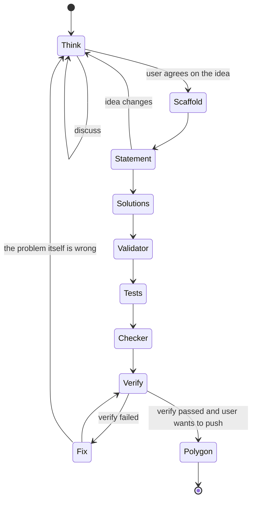
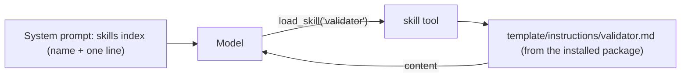
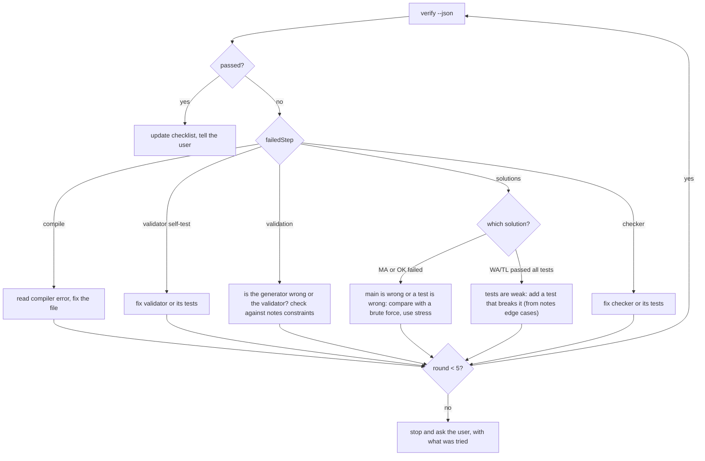

# 06: The problem-setting agent (M3)

This is the product. M1 and M2 give us a chat that can call tools. M3 makes it good at setting problems.

## The workflow

The agent follows these steps, but it is not a strict state machine. The user can jump, go back, or do a step by hand. The checklist in `notes.md` shows where we are.



| Step | What the agent does | Main tools | Skill files | Done when |
| --- | --- | --- | --- | --- |
| Think | Talk: story, constraints, intended solution and complexity, wrong approaches, edge cases, sample tests. No files. | `update_notes` | `working-rules.md` | The user says the idea is ok. Notes have constraints, solution, wrong approaches, edge cases. |
| Scaffold | Create the folder, download testlib, set the name and limits | `create_problem`, `update_config` | `config.md`, `commands/new.md` | `Config.json` exists with the right name and limits |
| Statement | Legend, input, output, notes, in the languages the user wants | `write_file`, `update_config` | `statements.md` | All statement files written and listed in `Config.json` |
| Solutions | Main (MA) first. Then OK alternatives, and WA / TL solutions from the wrong approaches in the notes | `write_file`, `update_config`, `run_solution` | `solutions.md`, `cpp-performance.md` | All solutions compile and pass the samples (except the wrong ones) |
| Validator | Validator from the constraints, plus validator tests (valid and invalid inputs) | `write_file`, `test_target` | `validator.md` | `polyman test validator` passes |
| Tests | Generators, the generator script, manual tests. Edge cases and max tests from the notes | `write_file`, `generate`, `validate` | `generators.md`, `generator-script.md`, `manual-tests.md` | All tests generated and valid |
| Checker | A standard checker if it fits, else a custom one with checker tests | `update_config`, `write_file`, `test_target` | `checker.md` | `polyman test checker` passes |
| Verify | Run verify, read the report, fix, repeat | `verify`, `read_file`, `edit_file`, `stress` | `commands/verify.md` | verify passes |
| Polygon | Push, commit, build the package (M4) | `remote_*` | `commands/remote.md` | Package ready |

## Notes file

`.polyman/agent/notes.md` is the memory of the problem. The agent reads it at the start of every session (it is part of the system prompt) and updates it when something is decided.

```markdown
---
version: 1
phase: tests
polygonProblemId: 123456
languages: [english, russian]
---

# Idea
Given an array, count pairs (i < j) with a_i + a_j = k.

# Constraints
- 1 <= n <= 2e5
- 1 <= a_i, k <= 1e9

# Intended solution
Sort + two pointers, or a hash map. O(n log n).

# Wrong approaches (planned solutions)
- wa-overflow.cpp: uses int for the answer (answer can be ~2e10) -> WA
- tl-brute.cpp: O(n^2) -> TL

# Edge cases (planned tests)
- all equal values, k = 2 * value
- n = 1
- answer near 2e10

# Decisions
- Time limit 1s, memory 256 MB.

# Checklist
- [x] think
- [x] scaffold
- [x] statement (english)
- [ ] statement (russian)
- [x] solutions
- [ ] validator
- [ ] tests
- [ ] checker
- [ ] verify
- [ ] polygon
```

```ts
interface NotesStore {
  read(): Promise<Notes | null>;
  update(patch: { section?: string; content?: string; check?: string; uncheck?: string; phase?: Phase }): Promise<Notes>;
}
```

The `update_notes` tool changes one section at a time, so the model does not rewrite the whole file and lose things.

Before `create_problem` there is no folder, so the notes live inside the session. `create_problem` writes them to the new folder.

## Skills

The skill files already exist in `template/instructions/`. The agent sees only the index in its system prompt and loads a file when it starts a step.



- Skills are read from the installed polyman package, not from the problem folder. So they work before the problem exists, and they always match the CLI version.
- If the problem folder has its own `instructions/` (from an older template), we still use the package version and say so in the index.
- The skill index is built at start by reading the first heading and first line of each file.

## System prompt (first idea)

Written for Gemma 4: short rules, one rule per line, plain words, and the most important rules first. A smaller model follows a short prompt better than a long one.

```
You are polyman, an assistant for competitive programming problem setters.
You help the user think about a problem, then build it with polyman and push it to Polygon.

How to work:
- In the Think step, ask questions and suggest ideas. Do not write files until the user agrees.
- Keep notes.md up to date with update_notes when something is decided.
- Before a step, load its skill with load_skill.
- After you change solutions, tests, validator or checker, run verify and read the report.
- When verify fails, find the reason first. Do not change a test to make a wrong solution pass.
- Never change Polygon without the user. Remote tools will ask the user, explain why before calling them.
- Prefer edit_file for small changes. Keep files short and in the style of the template.
- Always call tools with the tool call format. Never write a tool call as text.
- Do one step at a time. After each tool result, say in one line what you learned.

Skills: <index>
Environment: <os>, g++ <version>, java <version or missing>, python <version or missing>, polyman <version>
Problem: <folder or "none yet">
Notes: <notes.md>
Config summary: <name, limits, solutions with tags, testsets, checker, validator>
Files: <tree, names only>
```

## The Think step

This is the part users will value most, and it needs no tools. The agent should:

1. Ask about the idea until the task is exact (input, output, what is counted).
2. Suggest constraints and explain what they allow (n up to 2e5 means O(n log n)).
3. Find the intended solution and its complexity, and try to break it.
4. List wrong approaches that a contestant might try. Each one becomes a WA or TL solution later. This is how we know the tests are strong.
5. List edge cases. Each one becomes a test later.
6. Write all of this into the notes and ask "should I create the problem?".

We use the same model (Gemma 4 31B) for this step. If Gemma 4 sends reasoning through OpenRouter, the UI shows it dimmed and it is never sent back.

## The verify-and-fix loop



The digest the model gets from `verify` is short. For example:

```
verify FAILED at step "solutions"
- wa-overflow.cpp (WA): passed all 24 tests, expected at least one WA or PE
- main.cpp (MA): OK on all tests, max time 180 ms
Hint: the tests may not have an answer bigger than 2^31.
Full report: .polyman/agent/logs/c41.log
```

The hint is not from the model. It is from simple rules on the report (for example "a WA solution passed everything" gives "the tests may be weak").

## New CLI command: `polyman stress`

Useful for humans too, so it goes in the CLI, not only in the agent.

```
polyman stress <solution-a> <solution-b> --generator <name> --args "<args with {seed}>" [--iterations 1000] [--json]
```

- Runs the generator with a new seed each time, runs both solutions, compares the outputs with the problem checker.
- Stops at the first mismatch and saves the input to `stress/mismatch-<n>.txt`.
- The agent uses it when the main solution may be wrong (compare with a brute force) or to find a test that breaks a wrong solution.

## Problem-level tools added in M3

| Tool | Notes |
| --- | --- |
| `create_problem(name, dir?)` | `polyman new` + `download-testlib`, writes notes, moves the session, `problem_dir_changed` event |
| `update_config(patch)` | JSON merge patch, then validated against `Config.schema.json`. On error, nothing is written. |
| `add_solution(name, tag, source)` | writes the file and adds it to `Config.json` in one call (fewer mistakes than two tools) |
| `stress(...)` | wraps `polyman stress` |
| `load_skill`, `update_notes` | as above |
