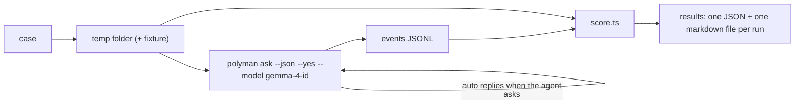

# 08: Evals, cost and release (M5)

## Why evals

We cannot say "Gemma 4 works" because one chat went well. We need numbers on the same tasks every time. The evals also catch regressions when we change the prompt, the tools or the budgets, and they tell us if the cheaper 26B-A4B model is good enough.

## Eval cases

```
evals/
  cases/
    pairs-sum/
      case.json        task, user replies, limits
      reference/       hidden: a correct solution and a few hidden tests
    shortest-path/
    ...
  run.ts               runner
  score.ts             scoring
  results/             JSON + markdown per run (gitignored)
```

```json
{
  "id": "pairs-sum",
  "kind": "full",
  "prompt": "I want a problem: count pairs with sum k. n up to 2e5. Build it with a WA solution for int overflow and a TL brute force.",
  "autoReplies": ["yes, go ahead", "english only"],
  "maxSteps": 120,
  "maxCostUsd": 1.0
}
```

Kinds:

| Kind | Starts from | Task |
| --- | --- | --- |
| `full` | empty folder | idea to passing verify |
| `fix` | a broken problem (copy of a fixture) | make verify pass |
| `tests` | a problem with weak tests | add tests until the WA solution fails |
| `validator` | a problem without validator | write the validator and its tests |

## Runner



## Scores

| Score | How |
| --- | --- |
| `verifyPassed` | `polyman verify --json` in the folder at the end |
| `correct` | the hidden reference solution passes the agent's tests, and the agent's main solution passes the hidden tests (catches "a problem that verifies, but is not the asked problem") |
| `testsStrong` | the WA and TL solutions from the case fail on the agent's tests |
| `steps`, `toolErrors` | from events |
| `tokens`, `costUsd`, `timeSec` | from `usage` events |

We run every case on `google/gemma-4-31b-it` and `google/gemma-4-26b-a4b-it`. The README shows both with their numbers, and the default is the cheaper one only if it passes about as many cases.

## Cost display

- `usage` events have tokens and the real cost, since OpenRouter returns the cost of each request.
- The status line shows this turn and the session total, and `/cost` shows the details.

## Docs

- `GUIDE.md`: a new "Chat" section (start, the OpenRouter key, permissions, workflow, notes, resume).
- `README.md`: a short section, how to get an OpenRouter key, and the eval numbers for both Gemma 4 models.
- A privacy note: what is sent to OpenRouter and the host that runs Gemma (statement, code, test samples, reports), and that the key stays on the machine.
- `template/CLAUDE.md` and `AGENTS.md`: mention `.polyman/agent/`.

## Release

- Version `4.0.0`: new commands and new exit codes are visible changes.
- Before release: run the evals on both Gemma 4 models, test `polyman chat` on Linux, macOS and Windows, check the install size with `ink` and `react`.
