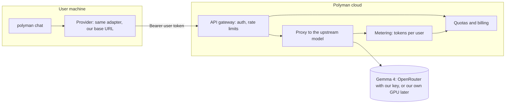
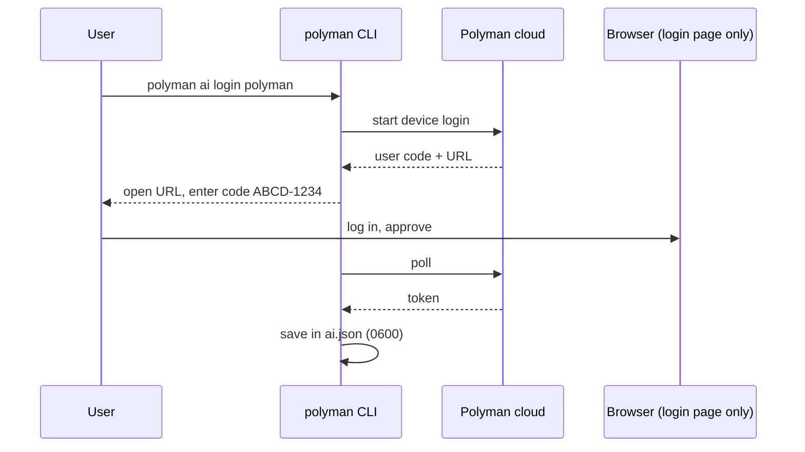

# 09: Polyman cloud (M6, later idea)

Some users will not want to get an OpenRouter key. The idea: we run a server, and they log in to it from polyman. This is only an initial idea. We build it after the evals show what a problem costs on Gemma 4.

## Main point

For the chat, the server is just one more provider (decision D6). It speaks the OpenAI Chat Completions format. Nothing in the agent changes.

## Login

## Things to decide before building

| Topic | Question |
| --- | --- |
| Cost | A full problem may take hundreds of thousands of tokens. Price per problem? Free quota? |
| Model | Gemma 4 31B or 26B-A4B, from the eval numbers. Since the weights are open, we could also host it ourselves. |
| Privacy | Unreleased contest problems go through our server. We must not store or log content. Write a clear policy. |
| Abuse | Rate limits per user, block non-polyman use (only the tools and prompt we send?). |
| Terms | Check the upstream provider terms for this kind of use. |
| Hosting | Where, and who pays. |

## Work items (later)

1. OpenAI-compatible proxy with streaming.
2. Accounts and device login.
3. Metering, quotas, billing.
4. Privacy policy and terms.
5. A `--cloud` option in the CLI that points the adapter to our server.
