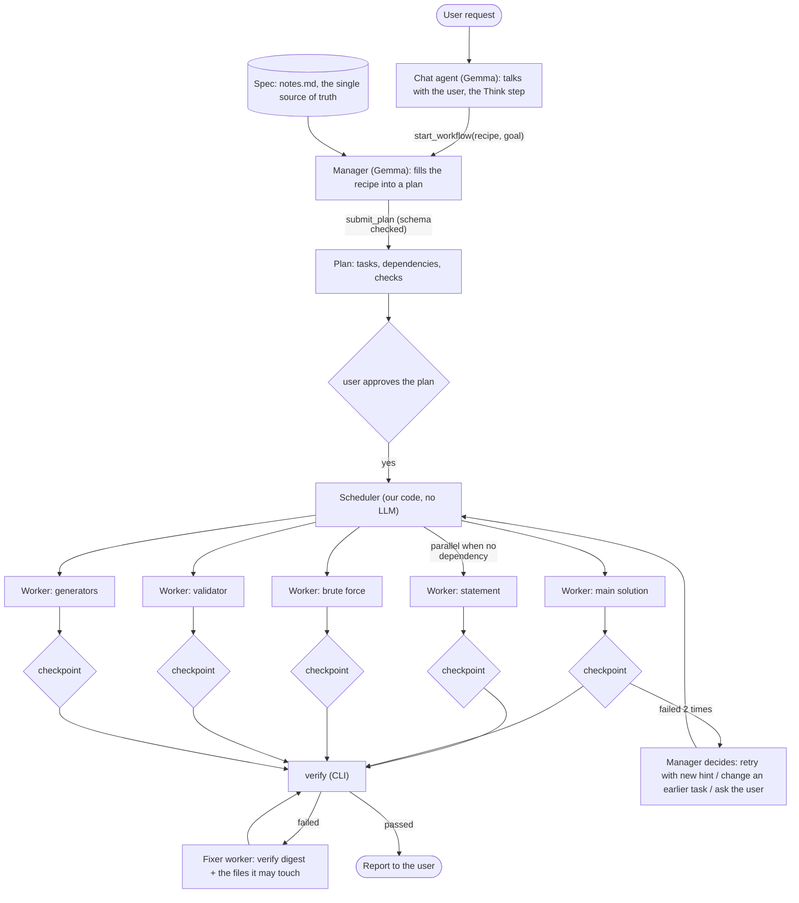
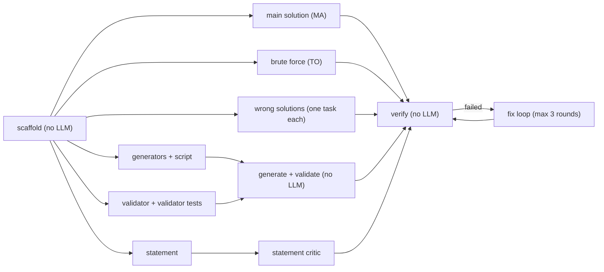
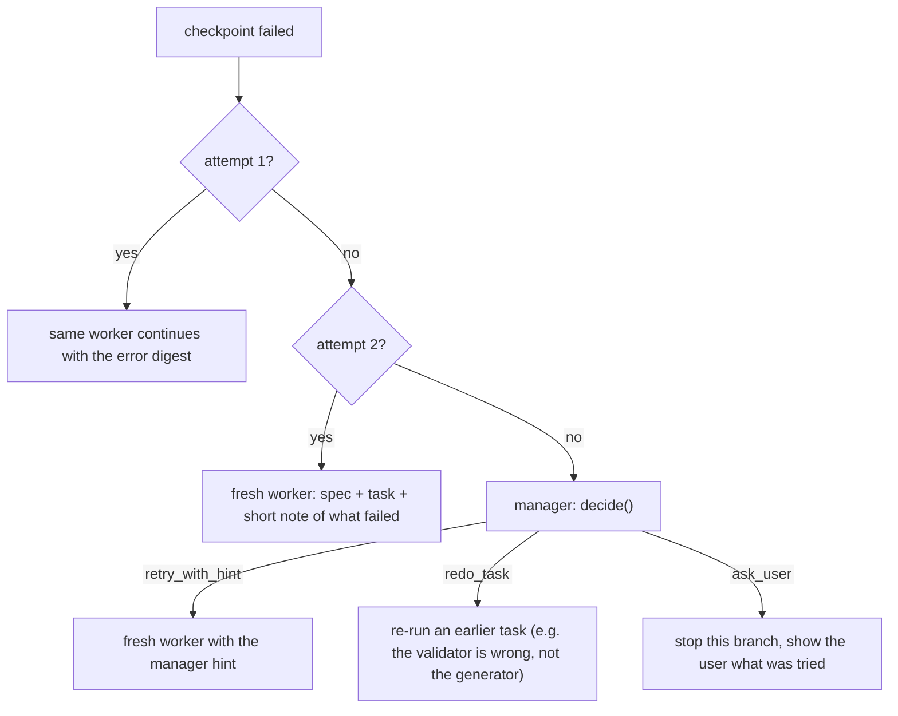

# 10: The workflow manager (Gemma, many turns)

This is the main idea of the agent, and what makes it different from "a chat with tools".

## The problem

One Gemma session with all the tools and one long prompt ("build this problem") does not work well. A smaller model in one long loop:

- loses the rules as the context grows,
- mixes tasks (writes the validator while fixing the statement),
- trusts its own work ("the solution is correct") without checking,
- gets stuck in loops and spends money.

The whole idea: **do not make Gemma smarter, make each of its tasks smaller and check every task with real tools.** A manager (Gemma) turns the request into a plan of small tasks. Each task runs as a fresh Gemma worker with a small context, a few tools and a clear goal. Each task ends at a checkpoint that the CLI checks, not the model.

## The big picture



Three roles, all Gemma 4, with different prompts, tools and budgets:

| Role | What it does | Context | Tools | Budget |
| --- | --- | --- | --- | --- |
| Chat agent | Talks with the user, runs the Think step, writes the spec, starts workflows, does small edits | the conversation + spec | notes, read tools, small edits, `start_workflow` | 20 steps per turn |
| Manager | Fills a recipe into a plan, handles escalations | spec + recipe + task results (short) | `submit_plan`, `decide` only | 3 steps per call |
| Worker | Does one task, then stops | spec + its task + its skill file + the files it owns | only the tools its task kind needs | 8 to 12 steps |

The scheduler, the checkpoints and the retry rules are our code. Gemma never decides if a task passed.

## Ten rules that push Gemma further

1. **Small context per worker.** A worker sees the spec, its task, one skill file and its own files. Around 8k to 16k tokens, never the whole conversation.
2. **Checks by the CLI, not by the model.** "Done" means it compiles, `polyman test validator` passes, `verify` passes. Not "the model says it is done".
3. **Decisions are choices from a list.** The manager does not write free text decisions. It calls `decide({ action: 'retry' | 'retry_with_hint' | 'redo_task' | 'ask_user', ... })`. Small models are much better at picking than at inventing.
4. **Recipes, not free planning.** We give the manager a known plan shape for each job (build a problem, add tests, fix verify). Gemma fills in the details (which wrong solutions, which generators, which checker). It does not invent the plan from nothing.
5. **Two independent solutions.** The main solution (MA) and a brute force are written by two different workers that do not see each other. The brute force is tagged `TO` (TLE or OK). `verify` fails if a `TO` solution gets WA, so it fails if the two disagree on any test the brute force finishes. This catches a wrong main solution without trusting either one.
6. **Fresh worker on the second retry.** The first retry continues with the error digest. The second retry starts a new worker with only the spec, the task and a short note of what failed. A context full of failed tries makes the model worse.
7. **Critic pass for text.** Text cannot be compiled, so the statement gets one extra critic worker with a fixed checklist (constraints match the spec, input and output format match the validator, samples are there). It answers with `review({ ok, issues[] })`.
8. **Single writer for `Config.json`.** Workers never edit `Config.json`. They return a small patch in their result (for example "add solution `brute.cpp` with tag `TO`"). The scheduler applies the patches one by one and checks them against `Config.schema.json`. No two workers fight over one file.
9. **Parallel where it is safe.** Independent tasks run at the same time (up to 4 workers, so we do not hit rate limits). Model calls run in parallel. CLI commands go through one lock in the `CliRunner`, so two compiles never fight over the cache or the timing.
10. **Thinking where it pays.** The manager, the main solution worker and the fixer get a bigger output budget and reasoning on (if Gemma 4 supports it through OpenRouter: check on the day with `polyman ai test`). Simple workers (statement, generators) run without it, so they are fast and cheap.

## Recipes

A recipe is a fixed plan shape in our code. The manager picks one (or the chat agent picks it in `start_workflow`) and fills the blanks.

### Recipe `build_problem` (the main one)

Input: an approved spec (notes.md with idea, constraints, intended solution, wrong approaches, edge cases, samples).



| Task | Kind | Worker tools | Checkpoint (our code) | Config patch |
| --- | --- | --- | --- | --- |
| scaffold | no LLM | none | `polyman new` + `download-testlib` succeed, name and limits from the spec are set | name, limits |
| statement | worker | `read_file`, `write_file` | files exist, every section not empty, then the critic says ok | statements |
| main solution | worker (thinking) | `read_file`, `write_file`, `run_solution` | compiles, correct output on the spec samples | add `MA` |
| brute force | worker | same | compiles, correct output on the spec samples | add `TO` |
| validator | worker | `read_file`, `write_file`, `test_target` | `polyman test validator` passes | validator |
| generators | worker | `read_file`, `write_file`, `generate` | compiles, the generator script runs | generators, testsets |
| wrong solution (each) | worker | `read_file`, `write_file`, `run_solution` | compiles | add `WA` or `TL` |
| checker | rule, no LLM | none | a standard checker from the output type in the spec (`ncmp` for numbers, `wcmp` for tokens, `yesno`) | checker |
| generate + validate | no LLM | none | all tests generated and valid | none |
| verify | no LLM | none | `verify` passes | none |

A custom checker is not in the first version. If the spec says "any valid answer", the recipe stops and tells the user.

### Recipe `fix_verify`

Run `verify`, read the digest, pick the files from the failed step, start a fixer worker that may only touch those files, run `verify` again. Max 3 rounds, then escalate to the manager, then ask the user.

### Recipe `strengthen_tests`

For a WA or TL solution that passed everything: a worker reads the wrong approach from the spec and writes a generator or a manual test that breaks it. Checkpoint: `run_solution` on the new test gives the expected verdict.

## Task results and the plan

```ts
// src/agent/workflow/types.ts
type TaskKind =
  | 'scaffold' | 'statement' | 'statement_critic' | 'main_solution' | 'brute_force'
  | 'wrong_solution' | 'validator' | 'generators' | 'checker'
  | 'generate_validate' | 'verify' | 'fix';

interface PlanTask {
  id: string;                 // 't3'
  kind: TaskKind;
  title: string;              // shown in the UI: "Main solution: sort + two pointers"
  dependsOn: string[];
  brief: string;              // what the manager wants, 1 to 5 lines
  ownsFiles: string[];        // the only files this worker may write
  params?: Record<string, string>; // e.g. { approach: 'int overflow', tag: 'WA' }
}

interface Plan {
  recipe: 'build_problem' | 'fix_verify' | 'strengthen_tests';
  tasks: PlanTask[];
}

interface TaskResult {
  taskId: string;
  status: 'passed' | 'failed' | 'skipped';
  attempts: number;
  summary: string;            // 1 to 3 lines, this is all the manager reads
  configPatch?: unknown;      // applied by the scheduler, never by the worker
  checkpoint: { name: string; ok: boolean; digest: string };
}
```

Plan checks before the user sees it (our code): exactly one `MA`, no cycles, every file owned by at most one task, every task kind known, and every wrong approach in the spec has a task. If the check fails, the manager gets the exact error and one more try.

## Escalation



Other tasks keep running while one task is escalated, unless they depend on it.

## Events and UI

New `AgentEvent` types, so the TUI can show the plan like the Claude Code todo list:

```ts
  | { type: 'plan_created'; plan: Plan }
  | { type: 'task_started'; taskId: string; attempt: number }
  | { type: 'task_checkpoint'; taskId: string; name: string; ok: boolean; digest: string }
  | { type: 'task_done'; taskId: string; result: TaskResult }
  | { type: 'workflow_done'; ok: boolean; summary: string; costUsd: number }
```

```
● Workflow: build_problem (pairs-sum)                     $0.08 · 3:12
  ✔ scaffold
  ✔ statement                     critic ok
  ⠋ main solution                 attempt 1 · run_solution on samples
  ✔ brute force (TO)
  ✗ validator                     attempt 2 · test validator: 1 of 6 failed
  ⠋ generators
  ◻ wrong solution: int overflow
  ◻ generate + validate           waits for validator, generators
  ◻ verify
```

Worker text is not printed in the transcript. `ctrl+o` on a task shows its last tool calls.

## Permissions

Asking for every file from 4 parallel workers would be unusable. So:

- The user approves the **plan**. The approval lists every task and every file it may write.
- After that, workers can write only their `ownsFiles` without asking. Writing any other file is refused by the sandbox (the sandbox gets the task's file list).
- Remote tools are never part of a workflow. Polygon still always asks.

This is the same risk as `auto-edit` mode for the files in the plan: the workers write code and the CLI runs it. The plan approval says this clearly.

## Budgets

| Setting | Value |
| --- | --- |
| Parallel workers | 4 |
| Worker steps | 8 (simple tasks), 12 (solutions, validator, fixer) |
| Worker context | 16k tokens |
| Manager steps per call | 3 |
| Fix rounds | 3 |

All are first guesses. The evals tune them.

## Source layout

```
src/agent/workflow/
  types.ts         Plan, PlanTask, TaskResult, TaskKind
  recipes.ts       build_problem, fix_verify, strengthen_tests: shape + plan checks
  manager.ts       Gemma manager: submit_plan, decide
  worker.ts        runs one task as a small AgentSession with its own tools and budget
  checkpoints.ts   the CLI checks per task kind
  scheduler.ts     DAG, parallel limit, retries, escalation, config patches
  prompts.ts       manager and worker prompts per task kind
```

`worker.ts` reuses `AgentSession` from the harness with a different prompt, tool list and budget. No second loop.
