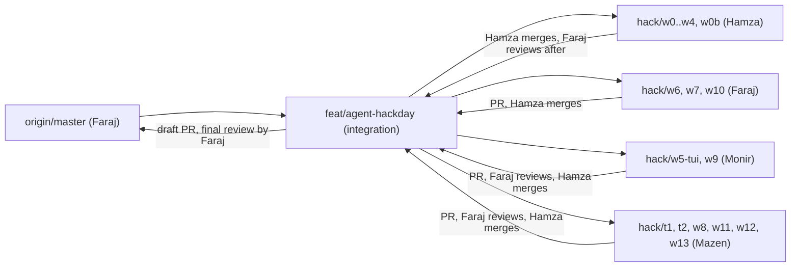

# 11: Hack day build plan (2026-10-26, building from 2:45 PM to 8:00 PM EEST)

Goal: build the first cut of `polyman chat` with the Gemma workflow manager ([10-workflow-manager.md](10-workflow-manager.md)) in about 4 hours, and keep the last 40 minutes for the demo and the submission. We started building at 2:45 PM, so every time below is the new plan.

Target at the end: **one problem goes from idea to a passing `verify` live, in under 5 minutes.**

## 1. Ground rules

- **No project code before 1:00 PM** (MLH rule). Before the event we only have the CLI that already exists, these design docs and the task briefs in [`briefs/`](briefs/). All of it is plan, no agent code.
- **Coding tools:** the organizers confirmed that Claude Code is allowed for writing the code. Hamza, Faraj (Claude Max) and Mazen use Claude Code. Monir uses Monir's own setup (Antigravity, OpenCode, GitHub Copilot, Codex).
- **The product runs on an open model:** the agent inside `polyman chat` runs on **Gemma 4** through OpenRouter. The submission and the PR say both things clearly.
- **The repo for the day: [Ahmad-Faraj/polyman](https://github.com/Ahmad-Faraj/polyman)** (Faraj's fork). Faraj adds Hamza, Monir and Mazen as collaborators with write access. Locally that repo is the `origin` remote; Hamza's own repo is `hamza`.
- **One integration branch: `feat/agent-hackday`** on that repo, from the latest `master` (`2993b99`). Its first commits are the plan and "keep only the test workflow". Every task branch comes back to it through a pull request. A draft PR from `feat/agent-hackday` to `master` stays open all day, and Faraj reviews it at the end.
- **CI: only the test workflow (`ci.yml`) runs.** The other workflows (CodeQL, corpus, mutation, nightly, docs deploy, release) are removed for the hack day, in one separate commit that we can revert later.
- **API keys never go in the repo.** Keys live in `~/.config/openrouter.env` (mode 600). Before every push: `git grep -n "sk-or-v1"` must find nothing.

## 2. Starting point (what already exists on `master`)

Checked on 2026-10-25 on v3.1.0 (build green, 2913 tests pass). On the day we start from `2993b99` (v3.1.0 plus small fixes):

| Exists, reuse it | Where |
| --- | --- |
| Exit codes 1 to 4 (problem wrong, bad input, missing tool, Polygon/network) | `src/errors.ts` (`PolymanError`) |
| `--json` on `new`, `list`, `generate`, `validate`, `run`, `test`, `verify`, remote commands | `src/cli.ts`, `src/report.ts` |
| Agent mode (`POLYMAN_AGENT=1`: no color, no prompts), `NO_COLOR` | `src/terminal.ts` |
| Provider layer: `Provider`, `StreamEvent` (tool calls carry `argsError`), `OpenAICompatibleProvider` with tool argument repair, `AnthropicProvider`, presets incl. OpenRouter, capabilities, retries, SSE parser, `MockProvider` | `src/agent/providers/` |
| `Message`, `ContentPart` | `src/agent/core/messages.ts` |
| `~/.polyman/ai.json`, `KeyStore`, `redact(text, keys)`, `polyman ai login/logout/list/models/use` | `src/agent/providers/key-store.ts`, `src/agent/ai-commands.ts` |

| Does not exist yet (the hack day builds it) |
| --- |
| Gemma models and OpenRouter options in the preset (W1, small) |
| Events, tool, runner, session and workflow contracts (W0) |
| Session loop, event bus, context trim (W2) |
| Tool registry, schema check, sandbox, permissions (W3) |
| CLI runner, file tools, CLI tools (W4) |
| Ink UI (W5, W9), workflow (W6, W7), `polyman chat` (W0b), e2e test (W10), evals (W8, W11) |

Some GitHub issues for these are closed, but the code is not there. Trust the code, not the issue state.

The agent code is **CommonJS**, like the rest of polyman (relative imports without an extension, as in `src/agent/providers/`). Only `src/agent/tui/` is ESM, because Ink is ESM-only.

## 3. People

| Lane | Who | Share | Does |
| --- | --- | --- | --- |
| A | Hamza | about 45% of the code | W0 contracts, W1 Gemma, W2 session, W3 tool infra, W4 CLI runner and tools, W0b wiring. All merges. Wave 3 tuning of the model side. The live demo. |
| D | Faraj | about 30% of the code, **main reviewer** | W6 scheduler and W7 Gemma brains (the whole workflow manager), W10 e2e test. Reviews every pull request into `feat/agent-hackday` and the final PR. Wave 3 tuning of the workflow side. |
| B | Monir | about 25% of the code | W5 terminal UI, W9 plan view, UI fixes from the bug lists, the README section, the slide, the demo terminal. |
| C | Mazen | tests and evals, all day | T1 test problems, T2 broken problems, W8 Gemma probe, W11 real runs, W12 safety tests, W13 single-loop baseline (the slide's main number). A test pass after every merge, bug lists, sorting the wave 3 failures, the backup recording. |

Rough size in hours of agent work: Hamza W0 (0.6), W1 (0.8), W2 (1.5), W3 (1), W4 (1.5), W0b (0.5), about 6 hours. Faraj W6 (2), W7 (1.5), W10 (0.7), about 4 hours, plus reviews. Monir W5 (2), W9 (1), polish (0.5), about 3.5 hours.

### Who tests what

Testing is shared. Nobody merges code without tests.

| Who | Tests |
| --- | --- |
| Everyone | Each task brings its own Vitest tests (the brief lists them). `npm run build && npm run lint && npm test` pass before a push. |
| Hamza | `polyman chat --plain` by hand after W0b; re-runs W11 on the case being tuned. |
| Faraj | W10, the end-to-end test of the whole workflow with a fake Gemma. Every review runs build, lint and test on the PR branch. |
| Monir | UI tests (store and components), and every key and screen tried in a real terminal. |
| Mazen | The test problems and broken problems, the Gemma probe, the real runs, the safety tests, the baseline, a test pass on `feat/agent-hackday` after every merge. |

### Nobody blocks Hamza

Hamza's lane is the critical path, so the other lanes are built to never stop it:

1. **Monir owns one folder: `src/agent/tui/**`.** Nothing in lane A imports from it except one dynamic `import('./tui/index.js')` in W0b. W0 installs the Ink dependencies, so Monir never touches `package.json`, `tsconfig.json` or any contract.
2. **Monir and Faraj code against the contracts, never against Hamza's code.** W5 runs on a fake session. W6 and W7 use fakes for the session, tools and checkpoints in their tests.
3. **W9 starts from Monir's own `hack/w5-tui` branch**, not from a merge.
4. **`polyman chat --plain` (W0b) works without the TUI.** Hamza tests and tunes on it. If the TUI is late or broken, the demo still runs.
5. **Merges happen at fixed times**: 4:50 (wave 1) and 5:45 (wave 2). If a branch is red after the merge, Hamza reverts it, tells the owner, and moves on.
6. **Reviews never block Hamza's own branches.** Hamza's lane A branches get a `/code-review` before the merge and Faraj reviews them after the merge (fixes go in the next merge). Faraj reviews the other lanes' pull requests before the merge.
7. **Bugs go to the owner of the file**, in one list per wave. Questions to Hamza go in one message per wave.

Everyone works on their own laptop and pushes `hack/...` branches to Faraj's repo. Only Hamza merges into `feat/agent-hackday`.

## 4. Tools

Hamza, Faraj and Mazen use **Claude Code** with Opus. Monir uses Monir's own tools (Antigravity, OpenCode, GitHub Copilot, Codex): the briefs are plain markdown, so any coding agent can take one. Give the agent the brief file and tell it to do exactly that task. Claude Code reads the repo's `CLAUDE.md`; Codex, OpenCode and Copilot read `AGENTS.md`, which points to the same file. Each task has a brief in [`briefs/`](briefs/): files owned, contracts used, what to build, the tests, when it is done.

### How to run a task

Each task runs in its own git worktree and its own terminal (tmux pane), so two tasks never build in the same folder:

```bash
# from the main checkout (~/polyman), on feat/agent-hackday
git worktree add ../pm-w3 -b hack/w3-tools feat/agent-hackday
ln -s "$PWD/node_modules" ../pm-w3/node_modules
cd ../pm-w3
claude --model opus --permission-mode acceptEdits \
  "Read design/agent/briefs/W3-tool-infra.md and do that task exactly. Commit once when build, lint and test pass. Do not push."
```

- `acceptEdits` lets it edit files without asking; shell commands still ask. Approve `npm` and `git` commands once per session with "don't ask again".
- Review, in the same worktree after the commit: run `/code-review` in a fresh `claude` session, or ask "Review the last commit (git show HEAD) against design/agent/briefs/W3-tool-infra.md. Only real bugs."
- Real bugs go back to the first session (it still has the context): "Fix these review findings: ...".
- Hamza runs 4 tasks at once in wave 1 (W1 to W4), Faraj runs 2 (W6, W7). Watch them, answer their questions, review each one when it commits.

### Keys

- Hamza's OpenRouter key is in `~/.config/openrouter.env` (`source` it in the terminal that runs `polyman chat` or the evals).
- Hamza makes a **second OpenRouter key** in the same account for Faraj, Mazen and Monir (probe, real runs, trying the chat), and revokes it after the event. It is shared in a private message, never in the repo.
- Tokens are not a concern for the day. Gemma runs cost cents. No cost cap in the product.

## 5. Git workflow



| Branch | Who writes | How it comes back |
| --- | --- | --- |
| `feat/agent-hackday` | Hamza only (merges, W0, W0b) | draft PR to `master`, reviewed by Faraj at the freeze |
| `hack/w1..w4` | Hamza's sessions | merged by Hamza after `/code-review`; Faraj reviews the merge commit after |
| `hack/w6-scheduler`, `hack/w7-brains`, `hack/w10-e2e` | Faraj | PR into `feat/agent-hackday`, Hamza merges at the merge time |
| `hack/w5-tui`, `hack/w9-plan-view` | Monir | PR, Faraj reviews, Hamza merges |
| `hack/t1-problems`, `hack/t2-broken`, `hack/w8-probe`, `hack/w11-real-runs`, `hack/w12-safety`, `hack/w13-baseline` | Mazen | PR, Faraj reviews, Hamza merges |

Commands:

```bash
# once, everyone
git clone https://github.com/Ahmad-Faraj/polyman.git && cd polyman
git switch feat/agent-hackday && npm ci && npm run build

# a task branch
git switch -c hack/w12-safety feat/agent-hackday
# ... work, commit ...
git push -u origin hack/w12-safety
gh pr create --base feat/agent-hackday --title "agent: safety tests" --body "Brief: design/agent/briefs/W12-safety-tests.md"

# Hamza, at the merge time
git fetch origin && git switch feat/agent-hackday && git pull
gh pr merge <n> --merge          # or: git merge --no-ff origin/hack/w5-tui
npm run build && npm run lint && npm test
git grep -n "sk-or-v1" && echo "KEY FOUND, DO NOT PUSH" || git push origin feat/agent-hackday
```

- Commit messages: `agent: ...` for agent code, `tui: ...` for the UI, `evals: ...` for probe and test problems, `docs: ...` for docs. Lowercase, short, like the repo log.
- Never force-push `feat/agent-hackday`.
- CI (`ci.yml`, the tests) runs on every push and PR. A red CI is fixed before the next merge.

## 6. Timeline

| Time | Hamza | Faraj | Monir | Mazen | Checkpoint |
| --- | --- | --- | --- | --- | --- |
| 2:45 to 3:20 | **Wave 0**: push the branch with the plan, run W0, push the contracts. | Add the collaborators. Read `10-workflow-manager.md`, the W6, W7, W10 briefs. Quick review of W0 at 3:15. | Clone, build. Read `05-chat-ui.md`, W5, the sample screens. Plan the UI on paper. | Clone, build. Start **W8 probe**. Start **T1 pairs-sum**. | 3:20: contracts on `feat/agent-hackday`, green |
| 3:20 to 4:50 | **Wave 1**: W1, W2, W3, W4 in 4 sessions. | **Wave 1**: W6, W7 in 2 sessions. PRs by 4:45. | **W5** on the fake session. PR by 4:45. | W8 report by 4:00. pairs-sum by 4:15. **T2** by 4:45. Then max-subarray, bracket-depth. | 4:50: wave 1 done and reviewed |
| 4:50 to 5:10 | **Merge** W3, W4, W1, W2, W6, W7, W5 (revert a red one). | Review W5 and the T1/T2/W8 PRs. Review Hamza's merges. | **W9** on top of `hack/w5-tui`. | Test the merged branch. | 5:10: one green build |
| 5:10 to 6:05 | **Wave 2**: W0b (`polyman chat`, `--plain`, `start_workflow`). 5:45: merge wave 2. | **W10** e2e test, PR by 5:40. Review the wave 2 PRs. | W9 PR by 5:40. Then the real chat after W0b. | **W11** and **W12** in 2 sessions, PRs by 5:40. Then **W13**. All T1 problems by 5:50. | 6:05: `polyman chat` works with the mock, and once with real Gemma |
| 6:05 to 6:50 | **Wave 3**: fix tool JSON, tool descriptions, budgets. | **Wave 3**: fix the manager prompt, plan checks, digests, retry hints. | UI fixes from the bug list. README section. | Run W11 and W13 after each fix, `fix_verify` on T2, sort failures to owners. Comparison table by 6:40. | 6:50: the target problem passes live |
| 6:50 to 7:20 | **Freeze**: last merge, PR text. | **Final review** of the whole draft PR. | The slide (Mazen's numbers), demo terminal. | Record the backup demo. Final test pass. | 7:20: PR ready, recording done |
| 7:20 to 8:00 | Practice the demo twice, submit. | Same. | Same. | Same, with a timer. | Submitted |

## 7. Task list

Every task has a brief in [`briefs/`](briefs/). A brief is the only thing a Claude Code session gets, so each one lists the exact files, the contract it uses, what to build, the tests to write and when it is done.

| Brief | Who | Branch | Starts | Owns |
| --- | --- | --- | --- | --- |
| [W0](briefs/W0-setup-and-contracts.md) setup and contracts | Hamza | `feat/agent-hackday` (main checkout) | 2:45 | Ink deps and the ESM `tui/` folder, the new contract files (events, tools, runner, session, workflow), the `chat` stub, OpenRouter fixtures |
| [W1](briefs/W1-provider.md) Gemma on OpenRouter | Hamza | `hack/w1-gemma` | 3:20 | edits in `src/agent/providers/{presets,openai-compatible,types}.ts`, new `src/agent/providers/gemma.ts` |
| [W2](briefs/W2-session.md) agent session | Hamza | `hack/w2-session` | 3:20 | `src/agent/core/{session,event-bus,context,text-tool-call}.ts` |
| [W3](briefs/W3-tool-infra.md) tool infrastructure | Hamza | `hack/w3-tools` | 3:20 | `src/agent/tools/{registry,schema,sandbox,permissions}.ts` |
| [W4](briefs/W4-runner-and-tools.md) CLI runner and tools | Hamza | `hack/w4-runner` | 3:20 | `src/agent/runner/{cli-runner,kill-tree,lock}.ts`, `src/agent/tools/{fs-tools,cli-tools}.ts` |
| [W6](briefs/W6-scheduler.md) workflow scheduler | Faraj | `hack/w6-scheduler` | 3:20 | `src/agent/workflow/{scheduler,checkpoints,recipes,config-patch,compile,spec}.ts` |
| [W7](briefs/W7-gemma-brains.md) prompts, manager, worker | Faraj | `hack/w7-brains` | 3:20 | `src/agent/workflow/{prompts,manager,worker}.ts`, `src/agent/core/prompt.ts`, `src/agent/skills.ts` |
| [W0b](briefs/W0b-wiring.md) wiring | Hamza | `feat/agent-hackday` (main checkout) | 5:10 | `src/agent/index.ts`, `src/agent/plain.ts`, `src/cli.ts` (`chat` command), `src/agent/tools/{workflow-tool,notes-tools}.ts` |
| [W5](briefs/W5-tui.md) terminal UI | Monir | `hack/w5-tui` | 3:20 | `src/agent/tui/**` |
| [W9](briefs/W9-plan-view.md) plan view | Monir | `hack/w9-plan-view` (from `hack/w5-tui`) | 4:50 | `src/agent/tui/components/PlanView.tsx`, `PlanApproval.tsx` |
| [T1](briefs/T1-test-problems.md) test problems | Mazen | `hack/t1-problems` | 2:45 | `evals/cases/**` (Claude Code can help, Mazen checks every file) |
| [W8](briefs/W8-gemma-probe.md) Gemma probe | Mazen | `hack/w8-probe` | 2:45 | `evals/probe/**` |
| [W10](briefs/W10-e2e-test.md) end-to-end test | Faraj | `hack/w10-e2e` | 5:10 | `tests/agent/e2e/**` |
| [W11](briefs/W11-real-runs.md) real runs | Mazen | `hack/w11-real-runs` | 5:10 | `evals/real/**` |
| [W12](briefs/W12-safety-tests.md) safety tests | Mazen | `hack/w12-safety` | 5:10 | `tests/agent/safety/**` |
| [W13](briefs/W13-baseline.md) single-loop baseline | Mazen | `hack/w13-baseline` | 5:40 | `evals/baseline/**` |
| [T2](briefs/T2-broken-problems.md) broken problems | Mazen | `hack/t2-broken` | 4:15 | `evals/broken/**` |
| [D1](briefs/D1-demo.md) demo material | Monir and Mazen | none | 6:05 | slide and README (Monir), recording and numbers (Mazen) |

## 8. Merge order and checks

- 4:50: **W3, W4, W1, W2, W6, W7** (tools before the code that uses them), then **W5**, then T1, T2, W8.
- 5:45: **W9, W10, W11, W12**, the rest of T1.
- 6:50: **W13** and the wave 3 fixes.

After each merge:

1. `npm run build && npm run lint && npm test`
2. Red on a lane A branch: fix in that worktree with the same session, merge again. Do not fix on `feat/agent-hackday` by hand unless it is one line.
3. Red on someone else's branch: `git reset --hard ORIG_HEAD`, send the error to the owner, go on. They push a fix to the same PR, it goes in at the next merge time.
4. `git grep -n "sk-or-v1"` finds nothing, then `git push`.

If two branches touch the same file, the brief ownership was wrong. Fix the ownership (one file, one owner) and merge again.

## 9. Wave 3: Gemma tuning loop

1. Mazen runs `node evals/real/run.mjs --case <id>` (from W11) and the baseline `node evals/baseline/run.mjs --case <id>` (W13). It runs the full workflow with real Gemma, auto-approves the plan, and writes `evals/real/results/<case>-<time>/report.md` (gitignored).
2. Mazen sorts each failure into one of these boxes and sends the list to the owner:

| Failure | Where to fix | Owner |
| --- | --- | --- |
| Broken tool JSON, tool call as text | `parseToolArgs` in `providers/openai-compatible.ts`, `core/text-tool-call.ts` | Hamza |
| Wrong tool picked, wrong args | tool descriptions in `cli-tools.ts` / `fs-tools.ts`, worker prompts | Hamza |
| Plan invalid | manager prompt in `workflow/prompts.ts`, plan checks in `recipes.ts` | Faraj |
| Checkpoint fails with an unclear digest | digests in `workflow/checkpoints.ts` | Faraj |
| Same mistake on every retry | retry note and the hint text in `scheduler.ts` | Faraj |
| Runs out of steps | budgets in `providers/gemma.ts` | Hamza |
| Looks wrong or confusing on screen | `src/agent/tui/**` | Monir |

3. The owner (Hamza or Faraj) runs one Claude Code session per box, with a small brief written on the spot.
4. Mazen runs again after each fix. Stop at 6:50 even if not perfect.

## 10. Cut lines

| Time | If late | Cut |
| --- | --- | --- |
| 4:50 | a wave 1 task is not done | merge what works. Drop: Windows kill path (W4), context trim (W2, keep only the step limit) |
| 4:50 | W5 is red or not ready | do not merge it. Hamza continues on `--plain`; W5 goes in at 5:45 |
| 5:10 | W6 or W7 is broken | workflow runs **sequentially** (parallel limit 1), no statement critic, one wrong solution only |
| 5:45 | W9 is not done | the plan shows as plain text lines in the transcript |
| 6:05 | real Gemma cannot finish one problem | demo the `fix_verify` recipe on a T2 broken problem, and the W8 probe numbers |
| 6:50 | anything | hard freeze, no new features |

## 11. Freeze and submission

- Final review: Faraj reviews the whole draft PR (`master...feat/agent-hackday`) with `/code-review`. Only real bugs get fixed.
- `npm run build && npm run lint && npm test`, push.
- The draft PR from `feat/agent-hackday` to `master` on Faraj's repo is marked ready. PR text:

```
## What
polyman chat: a terminal agent that builds Codeforces problems with Gemma 4.
A Gemma manager turns the idea into a plan of small tasks, small Gemma workers do them,
and the polyman CLI checks every task.
## Why
One long Gemma loop loses the rules and trusts its own work. Small tasks with real checks
get much more out of an open model.
## What existed before the hack day
The polyman CLI (v3.1.0) with exit codes and --json reports, the provider layer and polyman ai commands
in src/agent/providers/, the design docs in design/agent/ and the task briefs.
## What is new (built during the hack day)
The Gemma 4 models and OpenRouter options in the presets, and everything new under src/agent/
(core, tools, runner, workflow, tui), the chat command, the new tests under tests/agent/, and evals/.
## How it was built
Written by four people (Hamza, Faraj, Monir, Mazen) with AI coding agents (Claude Code, plus Antigravity, Copilot and Codex for the UI). The product runs on Gemma 4, an open model.
## How to test
1- npm install && npm run build
2- export OPENROUTER_API_KEY=...
3- node dist/cli.js chat ./my-problem
```

- MLH submission: both categories (Best Open-Source AI Project, Best Use of Gemma 4) if the organizers allow both. Link the PR and the recording.

## 12. Risks

| Risk | What we do |
| --- | --- |
| Wi-Fi drops | Phone hotspot. The backup recording for the demo. |
| A session writes broken code for a hard module | Stop it, start a fresh session with the brief plus "the last try failed because ..." |
| Merge conflicts | One owner per file. Contracts frozen at 3:20. Existing provider files are edited only by W1. Monir only touches `src/agent/tui/**`. |
| Ink and ESM problems | W0 proves the ESM `tui/` folder loads Ink from the CommonJS agent before anyone builds UI. `--plain` works without Ink. |
| A teammate blocks Hamza | Section 3 rules: fixed merge times, revert instead of debug, one question list per wave. |
| Gemma is weak at a task kind | Wave 3 boxes above. Cut that task kind from the recipe if it still fails at 6:40. |
| Faraj's reviews pile up | Faraj reviews in the order of the merge list. Anything not reviewed at the merge time waits for the next merge, Hamza does not wait. |
