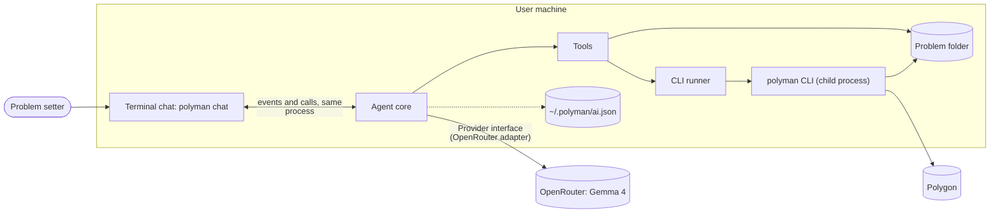
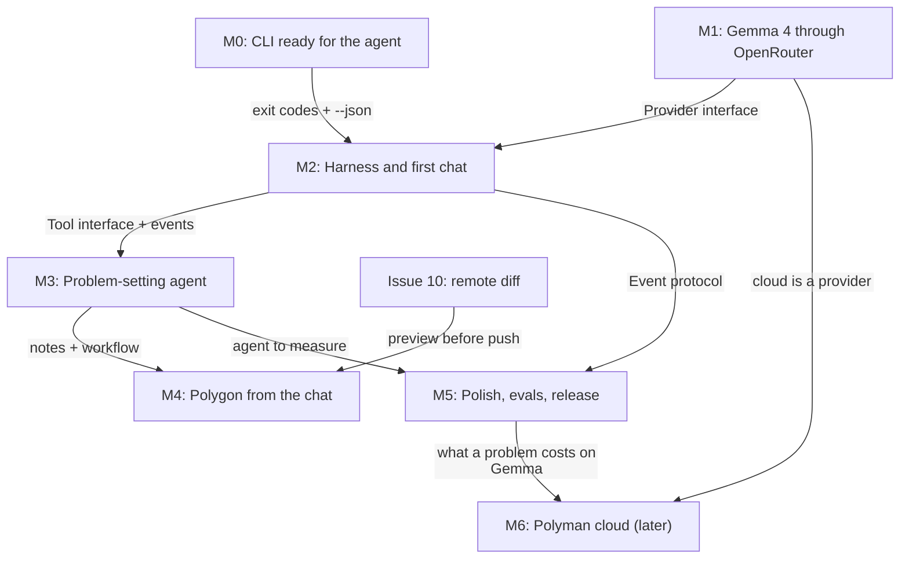

# Polyman Agent: design

Status: draft, initial ideas. Everything here can change while we build it.
Tracking issue: #30. Epics: M0 #31, M1 #32, M2 #33, M3 #34, M4 #35, M5 #36, M6 #37.

Update (2026-10-25): the agent is built and tuned for one model, **Gemma 4 through OpenRouter**. The provider layer from M1 stays as it is (other providers keep working), but the prompts, budgets, evals and demo target Gemma 4.

Code status on `master` (v3.1.0), checked on 2026-10-25:

| Part | Status |
| --- | --- |
| M0: exit codes 1 to 4 (`src/errors.ts`), `--json` on `generate`, `validate`, `run`, `test`, `verify`, `new`, `list`, remote commands, `POLYMAN_AGENT=1` and `NO_COLOR` (`src/terminal.ts`), Node engines field | done |
| M1: providers, presets (incl. OpenRouter), capabilities, key store, retries, SSE parser, mock, `polyman ai` commands | done |
| M2 to M5: session loop, tools, sandbox, permissions, CLI runner, TUI, `polyman chat`, workflow, evals, `polyman stress` | **not built** (some GitHub issues are closed, but there is no code) |

Many GitHub issues do not match the code. When an issue and these docs do not agree, these docs and the code win.

On the hack day the agent code is written with AI coding agents (Claude Code for most of it; the organizers allowed it). At runtime, the agent itself is Gemma 4 plus our own harness.

## What we are building

`polyman chat` opens a chat that works with the problem setter from the first idea to a ready Polygon problem:

1. Think about the problem with the user: the story, the constraints, the intended solution, wrong approaches and edge cases.
2. Create the problem folder, then write the statement, `Config.json`, solutions, validator, generators, checker and tests.
3. Run `verify`, read the failures, fix them, and repeat until it passes.
4. Push to Polygon, commit and build the package, always after the user says yes.

The model is Gemma 4 (`google/gemma-4-31b-it` by default) through OpenRouter. Users bring their own OpenRouter key. Gemma 4 is an open-weights model, so the whole stack is open: our harness plus an open model. Later we may run our own server so users can use the chat without a key ("polyman cloud").

## Goals

- The chat is part of polyman. Users do not need any other agent tool.
- One model family, Gemma 4, so we can tune the prompt, the tools and the budgets for it, and measure it well.
- A failed tool call or bad output from the model is something the model can fix, never a crash. Gemma is smaller than the frontier models, so the harness must expect mistakes.
- The agent never breaks the problem silently: every change is a file the user can see, and every Polygon change needs approval.
- The CLI stays the source of truth. The agent uses the same commands a human uses.

## Non-goals (for now)

- No free shell tool. The agent can only run polyman commands and edit files inside the problem folder.
- No multi-user or team chat.
- No IDE extension and no web UI. The chat lives in the terminal, like Claude Code or Codex.
- No hosted server in the first release (see [09-cloud.md](09-cloud.md)).
- No tuning or evals for other providers (OpenAI, Anthropic, DeepSeek, ...). They work through the existing adapters, without promises. Running Gemma locally with Ollama is a good later step for private problems.

## Decisions

| # | Decision | Why |
| --- | --- | --- |
| D1 | The agent runs the polyman CLI as a child process. It does not import `actions.ts` or `steps.ts`. | A crash or `process.exit` in the CLI cannot kill the chat. No big refactor of the core. |
| D2 | One npm package (`polyman-cli`). The agent code is loaded with `import()` only by `chat`, `ask` and `ai` (like `ai-commands.ts` today). The agent code is CommonJS like the rest of polyman; only `src/agent/tui/` is ESM, because Ink is ESM-only. | `polyman verify` does not get slower to start. One version to install. |
| D3 | The chat is a terminal UI (TUI) built with Ink, in the same process as the agent. Like Claude Code or Codex. | Problem setters already live in the terminal. No server, no ports, no browser. |
| D4 | One target model: Gemma 4 through OpenRouter, on the existing `OpenAICompatibleProvider` with the OpenRouter preset. The other adapters stay but are not tuned. | One model we can tune and measure. Open weights. OpenRouter gives one OpenAI-compatible endpoint, both Gemma 4 sizes and free variants for development. |
| D5 | The agent core and providers add no runtime dependencies (`fetch`, our own SSE parser). The TUI adds `ink`, `react` and `marked`, loaded only by `polyman chat`. | Ink solves streaming, redraw and input, which is a lot of work to write ourselves. Other commands do not load it. |
| D6 | The hosted server, if we build it, is just one more provider. | The chat does not change when the server comes. |
| D7 | Long-term memory is a notes file in the problem folder (`.polyman/agent/notes.md`). | Long sessions lose context. A new session must know what was decided. |
| D8 | Knowledge comes from `template/instructions/*.md`, loaded as skills when needed. | This knowledge already exists and is kept up to date with the CLI. |
| D10 | A workflow manager on top of the chat: a Gemma manager fills a recipe into a plan, small Gemma workers do one task each (in parallel when safe), and our code checks every task with the CLI. See [10-workflow-manager.md](10-workflow-manager.md). | One long Gemma loop loses the rules and trusts its own work. Small tasks with real checks get much more out of the same model. This is the main idea of the agent. |
| D11 | Inside a workflow the user approves the plan once, then workers write only the files their task owns. Polygon is never part of a workflow. | Approving every file from 4 parallel workers is unusable. The sandbox still blocks every file outside the task. |
| D9 | Budgets made for a smaller model: 20 steps per turn, 32k tokens of context, 8 KB per tool result, about 10 tools. | Gemma follows the rules worse in long contexts and long loops. It also caps the cost of a stuck loop. See [03-providers.md](03-providers.md). |

## The big picture

## Documents

| File | What it covers | Milestone |
| --- | --- | --- |
| [01-architecture.md](01-architecture.md) | Components, layers, source layout, main flows, data on disk, security, testing | all |
| [02-cli-contract.md](02-cli-contract.md) | Exit codes, `--json` reports, running without a terminal | M0 |
| [03-providers.md](03-providers.md) | The model: Gemma 4 through OpenRouter, the adapter, Gemma quirks and budgets, the key, retries | M1 |
| [04-harness.md](04-harness.md) | Agent loop, events, tools, permissions, CLI runner, sessions, context | M2 |
| [05-chat-ui.md](05-chat-ui.md) | Terminal chat UI: look, Ink setup, components, keys, slash commands | M2, M5 |
| [06-problem-agent.md](06-problem-agent.md) | The problem-setting workflow, notes, skills, tools per step | M3 |
| [07-polygon.md](07-polygon.md) | Polygon tools, approvals, preview before push | M4 |
| [08-evals-release.md](08-evals-release.md) | Eval suite, cost, docs, release | M5 |
| [09-cloud.md](09-cloud.md) | The hosted server idea | M6 |
| [10-workflow-manager.md](10-workflow-manager.md) | The Gemma workflow manager: manager, workers, recipes, checkpoints, escalation | M3 (first cut on the hack day) |
| [11-hackday-plan.md](11-hackday-plan.md) | How we build the first cut in one day: three lanes, Claude Code sessions in worktrees | hack day |

## Milestones and how they connect

Each arrow is a contract. If the contract is stable, the two sides can be built in parallel:

| Contract | Defined in | Produced by | Used by |
| --- | --- | --- | --- |
| Exit codes and `--json` reports | [02-cli-contract.md](02-cli-contract.md) | M0 (CLI) | M2 runner, M3 and M4 tools |
| `Provider` and `StreamEvent` | [03-providers.md](03-providers.md) | M1 adapters | M2 agent loop |
| `Tool` and `ToolContext` | [04-harness.md](04-harness.md) | M2 | M3 and M4 tools |
| `AgentEvent` and `AgentSession` methods | [04-harness.md](04-harness.md) | M2 core | Terminal UI, `polyman ask`, evals |
| `notes.md` format | [06-problem-agent.md](06-problem-agent.md) | M3 | M4, M5, new sessions |

Order: M0 first. M1 and M2 together (M2 can start with the mock provider). Then M3, which is the product itself, then M4 and M5. M6 only after the evals give real numbers.

M0 and M1 are done (see the status table at the top). The hack day starts at M2.

## First cut (hack day, 2026-10-26)

The build plan for the hack day is in [11-hackday-plan.md](11-hackday-plan.md), with one brief per task in [`briefs/`](briefs/) (the short version of every task is in [`briefs/README.md`](briefs/README.md)): Hamza on the core, Faraj on the workflow manager and as the main reviewer, Monir on the terminal UI, Mazen on tests and evals all day. We work on [Ahmad-Faraj/polyman](https://github.com/Ahmad-Faraj/polyman). M0 and M1 already exist, so the first cut is M2 plus the workflow manager from M3.

## Glossary

- **Turn**: one user message and everything the agent does until it answers.
- **Step**: one model call inside a turn. A turn can have many steps (model, tools, model, tools, ...).
- **Tool**: a function the model can call, like `verify` or `write_file`.
- **Skill**: a markdown guide from `template/instructions/` the agent loads when it needs it.
- **Session**: one chat, saved to disk so it can be resumed.
- **Notes**: `.polyman/agent/notes.md`, the long-term memory of a problem. Also called the spec, since every worker reads it.
- **Workflow**: a plan of tasks made by the manager from a recipe, run by the scheduler.
- **Manager**: the Gemma role that fills a recipe into a plan and decides on escalations.
- **Worker**: a fresh, small Gemma session that does one task.
- **Checkpoint**: the CLI check at the end of a task (compiles, `test validator` passes, `verify` passes).
