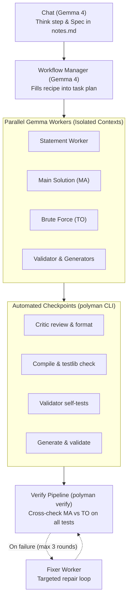

# Slide: Many small Gemmas, checked by the CLI

> **Format**: 16:9 Presentation Slide  
> **Topic**: Polyman Agent Architecture & Empirical Results  
> **Authors**: Hamza Hassanain, Monir, Mazen Ghanayem  
> **Context**: Hack Day Demo (D1)

---

# Many small Gemmas, checked by the CLI

### 16:9 Slide Layout Overview

```
┌───────────────────────────────────────────────────┬───────────────────────────────────────────────────┐
│ LEFT: Real Numbers Only                           │ RIGHT: Workflow Architecture                      │
│                                                   │                                                   │
│ 1. Gemma Probe (W8)                               │  Chat (Think & Spec in notes.md)                  │
│    • Model: gemma-4-31b                           │         │                                         │
│    • Tool choice: 30/30 right tool (100%)         │         ▼                                         │
│    • JSON: Always valid                           │  Manager (Fills recipe into task plan)            │
│    • Cost: ~$0.0003 per call                      │         │                                         │
│                                                   │    ┌────┴──────────┬──────────┬─────────┐         │
│ 2. First Real Runs (W11)                          │    ▼               ▼          ▼         ▼         │
│    • Problem: max-subarray                        │  Worker          Worker     Worker    Worker      │
│    • Result: Built & verify passed                │  (Statement)     (MA)       (TO)      (Gen/Val)   │
│    • Time: 3.3 min                                │    │               │          │         │         │
│    • Cost: $0.02                                  │    ▼               ▼          ▼         ▼         │
│                                                   │  Checkpoints (CLI: compile, testlib, self-tests)  │
│ 3. Baseline Comparison (W13)                      │    │                                              │
│    • Workflow vs. One Long Loop                   │    ▼                                              │
│    • [TODO: Mazen baseline comparison table]      │  Verify (polyman verify end-to-end)               │
├───────────────────────────────────────────────────┴───────────────────────────────────────────────────┤
│ BOTTOM: Three Invariant Rules                                                                         │
│ 1. The CLI decides "done" — automated checkpoints & compilers verify, never the model itself          │
│ 2. Two blind solutions cross-check each other — independent MA vs. TO (brute force) cross-validation  │
│ 3. A fresh worker on retry — clean context resets prevent error-loop hallucinations                  │
├───────────────────────────────────────────────────────────────────────────────────────────────────────┤
│ FOOTER: https://github.com/Ahmad-Faraj/polyman · Runs on Gemma 4, an open model · Built in one day   │
└───────────────────────────────────────────────────────────────────────────────────────────────────────┘
```

---

## Slide Content

### Left Column: Real Numbers Only

#### 1. Gemma Tool Probe (`evals/probe/` · W8)
*Empirical evaluation of `google/gemma-4-31b-it` across representative competitive programming tool calls:*
- **Right tool selection**: **30 / 30** (100% correct tool choice)
- **JSON validity**: **JSON always valid** (100% parse rate without syntax errors or repair)
- **Cost efficiency**: **~$0.0003 per call**

#### 2. First Real Runs (`evals/real/` · W11)
*Autonomous problem creation from specification to verified package:*
- **Problem**: `max-subarray` (statement, reference solution, brute force, validator, tests)
- **Result**: Built and `verify` passed
- **Wall-clock time**: **3.3 min**
- **Total cost**: **$0.02**

#### 3. Baseline Comparison: Workflow vs. One Long Loop (W13)
*Side-by-side comparison between multi-worker architecture and a single monolithic Gemma loop:*

| Metric | Polyman Workflow (W11) | One Long Loop Baseline (W13) |
| --- | :---: | :---: |
| **Problem** | `max-subarray` | `max-subarray` |
| **Verify passed** | **Passed** | <!-- TODO: baseline verify result --> |
| **Hidden checks passed** | **Passed** | <!-- TODO: baseline hidden checks result --> |
| **Time** | 3.3 min | <!-- TODO: baseline time --> |
| **Gemma calls** | ~15 calls | <!-- TODO: baseline calls --> |
| **Cost** | $0.02 | <!-- TODO: baseline cost --> |
| **Wrong solutions caught by tests** | Yes | <!-- TODO: baseline wrong solutions caught --> |

> **TODO**: Baseline comparison numbers from W13 single-loop baseline will be added here once Mazen's baseline runs are complete.

---

### Right Column: Workflow Diagram



---

### Bottom: Three Rules

1. **The CLI decides "done"**: The model never evaluates whether its own code works. Real compilers (`g++`), `testlib.h` validators, and `polyman verify` decide every checkpoint.
2. **Two blind solutions cross-check each other**: The main solution (`MA`) and brute force (`TO`) are written by two separate workers that never see each other. Disagreements on generated tests fail the build immediately.
3. **A fresh worker on retry**: A failed attempt does not pollute context with error noise. Retries spawn fresh workers with only the spec, the task, and a clean error digest.

---

### Footer

- **GitHub**: [https://github.com/Ahmad-Faraj/polyman](https://github.com/Ahmad-Faraj/polyman)
- **Note**: Runs on Gemma 4, an open model. Built in one day by Hamza, Monir and Mazen.
